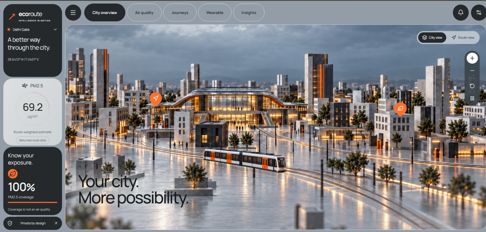
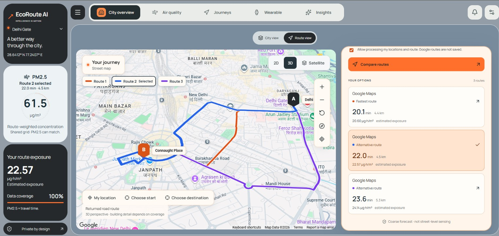
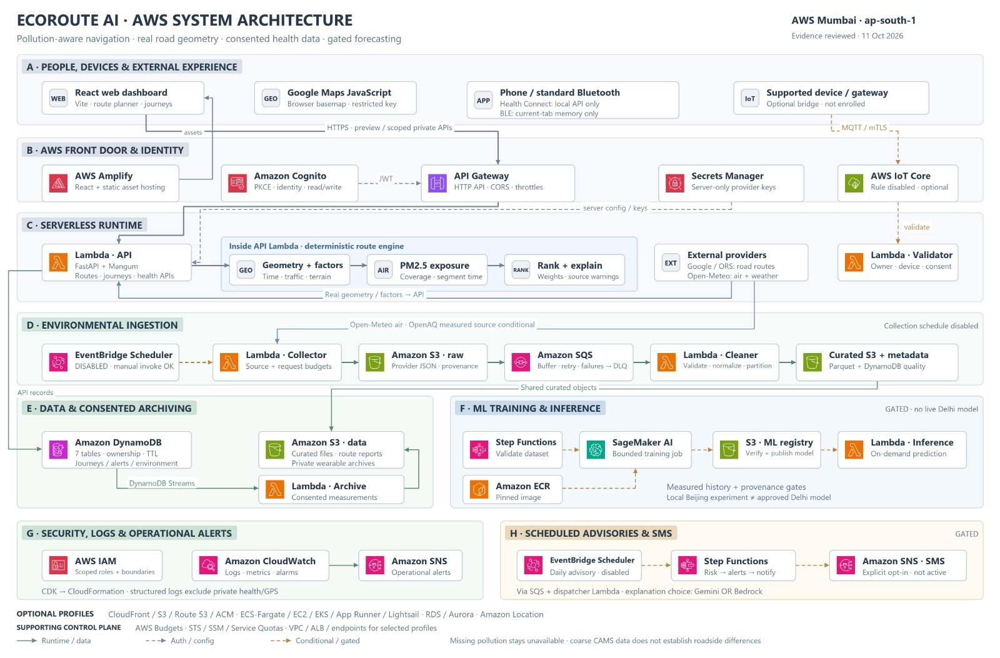
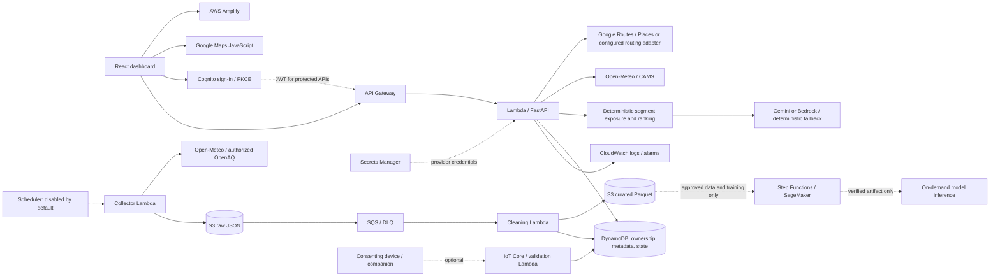

<div align="center">

# EcoRoute AI

### Know your route. Understand your exposure.

An AWS-native journey planner built for Delhi that combines genuine road routes, environmental forecasts and transparent exposure calculations to help people compare their travel options.


[](LICENSE)

**Real routes · Pollution forecasts · Estimated exposure · Grounded explanations · Consent-based wearables**

[Open application](https://main.d3txif33djiy59.amplifyapp.com/) · [Getting started](#run-locally) · [Architecture](#architecture) · [API contract](docs/FRONTEND_INTEGRATION.md)

</div>

> [!IMPORTANT]
> EcoRoute compares **estimated environmental exposure**, not medical risk or dose. Coarse atmospheric models cannot establish precise street-level pollution differences. Missing data stays unavailable; wearable heart rate does not prove a pollution effect.

## Watch the walkthrough

[](https://youtu.be/4XNr6BEzIzI)

**[Watch on YouTube](https://youtu.be/4XNr6BEzIzI)** — Explore route comparisons, air-quality estimates and AI insights.

## Experience



Delhi is the primary city for this project. The city showcase is illustrative artwork, not a reconstruction of Delhi streets. It opens into a real route map; users can choose their own locations, subject to provider coverage. Choose public places or map points, select Drive, Walk or Cycle, and compare duration, distance and available pollution estimates. Mode availability depends on the configured routing provider and its coverage.



*User-supplied screenshots show an earlier application state, not current pollution readings. Some labels and controls have since changed. The city artwork is illustrative; the journey map uses provider road geometry.*

## What EcoRoute does

| Capability | How it works |
| --- | --- |
| Route comparison | Google Routes/Places integration, optional Amazon Location V2 adapters and OpenRouteService cycling support. Provider geometry is preserved; no straight-line substitute is invented. |
| Environmental data | Open-Meteo/CAMS modeled forecasts and an OpenAQ v3 observation adapter. Source, units, timestamps, freshness and geographic support travel with each record. |
| Exposure scoring | Segment-level concentration multiplied by traversal time, with fastest, lowest estimated exposure and balanced objectives plus a detour limit. |
| Insights | Configurable Gemini or Bedrock integration explains approved calculated facts. Deterministic summaries remain available when an LLM cannot be used. |
| Wearables | Device ownership, consent, revocation and protected telemetry APIs; optional IoT and local Android Health Connect bridges. Physical Noise watch access is not assumed. |
| Forecasting | Leakage-aware station forecasting, persistence comparison, local evaluation and bounded SageMaker job definitions. A model must be validated before activation. |
| Operations | Python CDK, scoped IAM, Secrets Manager, structured logs, queues, dead-letter queues and disabled-by-default scheduled workflows. |

## Architecture

The primary deployment uses **AWS Mumbai (`ap-south-1`)** with Amplify hosting and Lambda/API Gateway. Optional compute and database profiles are not needed for the default serverless application.



*Architecture overview supplied for this project, reviewed 11 October 2026. Dashed paths are conditional or gated; the diagram is not a claim that every service is active. The explanation provider is configurable; verified recent route explanations used Gemini.*



See [architecture details](docs/ARCHITECTURE.md), [AWS service inventory](docs/AWS_SERVICES.md) and [project state with verification evidence](docs/PROJECT_STATE.md).

## How a route is selected

1. Resolve the chosen endpoints and request genuine, mode-compatible road routes.
2. Divide each route into distance-based segments and estimate segment travel times.
3. Match pollution data by location and time, preserving freshness and uncertainty.
4. Calculate concentration-time exposure:

   **E = Σ(PM2.5 concentration in µg/m³ × segment duration in hours)**

5. Apply the selected objective and maximum detour. Compare exposure changes against the documented baseline.

Traffic-aware duration is used when supplied by the routing provider. Optional weather and terrain preferences depend on available data and travel mode. If all candidates share one coarse pollution grid cell, exposure differences can reflect **time spent traveling**, not cleaner individual streets. Partial coverage does not become a complete exposure estimate.

[Routing algorithm](docs/ROUTING.md) · [Route factors](docs/ROUTE_FACTORS.md) · [Provider activation](docs/PROVIDER_ACTIVATION.md)

## Verified status and limits

This table summarizes recorded project evidence; it is not a live health monitor.

| Area | Recorded status |
| --- | --- |
| Hosting | Public Amplify application; backend API Gateway and Lambda deployed. |
| Routing | Live Google Drive comparisons verified in Delhi and Mumbai. Other modes/locations require provider coverage and configuration. |
| Air quality | Real Open-Meteo ingestion and curated metadata verified. A Mumbai comparison on 11 October 2026 returned full modeled PM2.5 coverage after the hourly matching repair. |
| OpenAQ | Adapter exists; actual station availability, credentials and coverage determine measured-data results. |
| Explanations | Gemini-backed grounded explanations verified; Bedrock is an alternative, not a required active dependency. |
| ML | Local training/evaluation tooling and SageMaker infrastructure exist. No paid SageMaker training success or approved live Delhi model is claimed here. |
| Wearables | Secure backend and bridge contracts exist. No claim of verified direct Noise ColorFit Pro3 Alpha cloud telemetry. |
| Automation | Collection/advisory schedules and SMS remain gated. No claim of a delivered SMS. |
| CloudFront | Optional hosting path; the current frontend uses Amplify instead. |

## Local forecasting experiment

A documented experiment used **420,768 real historical rows from 12 Beijing stations**,
with chronological splits and 81,979 test examples. It is not a Delhi navigation model.

| Model | Test MAE (µg/m³) | Test RMSE (µg/m³) |
| --- | ---: | ---: |
| Persistence baseline | 10.09034 | 19.56450 |
| Random Forest | 9.75243 | 18.71309 |
| HistGradientBoosting | 9.87563 | 19.47162 |

These are recorded **local CPU evaluation** results, not SageMaker results or evidence of
current Indian route accuracy. [Dataset, license, limits and reproduction](docs/LARGE_DATA_TRAINING.md)
· [Machine-readable report](examples/ml/uci-beijing-training-report.json).

## Run locally

Prerequisites: **Python 3.11–3.13**, **Node.js 22**, npm, and Git. Docker is needed for container checks. AWS CLI credentials are needed only for explicitly enabled AWS operations.

```powershell
git clone https://github.com/deveshsinghal09/ecoroute-ai.git
cd ecoroute-ai
py -3.11 -m venv .venv
.\.venv\Scripts\Activate.ps1
python -m pip install -r requirements.lock
python -m pip install --no-deps -e .
npm ci
npm --prefix frontend ci
Copy-Item .env.example .env
Copy-Item frontend/.env.example frontend/.env.local
npm run dev
```

On Linux/macOS, create the environment with `python3 -m venv .venv`, activate with `source .venv/bin/activate`, and use `cp` for the two example files. Copy examples only on first setup; preserve existing configuration.

- Dashboard: `http://127.0.0.1:5173`
- Local API docs: `http://127.0.0.1:8000/docs`
- Health: `http://127.0.0.1:8000/api/v1/health`

The local runner starts both servers. Historical preview is not live data; real providers require configuration. Do not enable live features by substituting fabricated measurements.

### Configure providers securely

| Configuration | Where it belongs |
| --- | --- |
| Browser Google Maps key | `VITE_GOOGLE_MAPS_API_KEY` in `frontend/.env.local`, or Amplify build variables. Restrict it by website referrer and API. It is public browser configuration. |
| API base URL and Cognito public IDs | Frontend configuration; see the frontend example file and Amplify guide. |
| Google Routes, OpenRouteService, OpenAQ and Gemini server keys | Ignored root `.env` for local use; Secrets Manager references for deployed Lambda. Never put them in `VITE_*` variables. |
| AWS access | Authorized CLI profile with temporary credentials where possible. Never root access keys or committed credentials. |

Follow the [credential checklist](docs/CREDENTIALS_CHECKLIST.md), [Google Maps setup](docs/GOOGLE_MAPS_SETUP.md), [Amplify connection guide](docs/AMPLIFY_CONNECTION.md) and [ordered AWS setup](docs/AWS_SETUP_FROM_ZERO.md). Do not share secrets in issues or chat.

## Development checks

```powershell
python -m pip install -r requirements-ml.txt
python -m ruff check .
python -m pytest -q
python scripts/smoke_local.py
python scripts/check_repo.py
npm --prefix frontend test
npm --prefix frontend run build
npm --prefix frontend run test:e2e
npm run synth
```

Playwright uses Edge locally on Windows and Chromium in CI. Install the appropriate browser when absent. CDK synthesis may require building the Lambda asset first: `python scripts/build_lambda.py`. The GitHub workflow also exercises Docker, API contract export, dependency auditing and infrastructure security checks. Tests do not prove successful live deployment.

## Repository map

```text
frontend/           React dashboard, maps, wearable showcase and UI tests
src/ecoroute/       FastAPI APIs, provider adapters, routing, ML and handlers
infra/              Python CDK stacks and optional deployment profiles
scripts/            Local development, ingestion, training and operations
tests/             Backend, infrastructure and security tests
examples/           API requests, Postman collection and labeled recordings
docs/               Architecture, credentials, costs and operational evidence
```

## Documentation

- **Build and integrate:** [API contract](docs/API_CONTRACT.md), [frontend integration](docs/FRONTEND_INTEGRATION.md), [OpenAPI](docs/openapi.json), [Postman collection](examples/ecoroute.postman_collection.json).
- **Data and ML:** [ingestion](docs/INGESTION.md), [ML workflow](docs/ML_WORKFLOW.md), [large-data training](docs/LARGE_DATA_TRAINING.md).
- **Devices and workflows:** [wearables](docs/WEARABLES.md), [Health Connect](docs/HEALTH_CONNECT.md), [advisories](docs/PHASE6_ADVISORIES.md).
- **Operate safely:** [costs and budgets](docs/COSTS_AND_BUDGET.md), [deployment profiles and cleanup](docs/MULTISERVICE_INTEGRATION.md), [demo runbook](docs/DEMO_READINESS.md).

## Costs and cleanup

The previously reviewed small serverless demo estimate was **$5–20/month**, excluding external provider charges, tax, paid ML jobs and SMS. Actual usage, account eligibility and pricing determine the bill. AWS credits do not cover every external provider, and **budget alerts do not hard-cap spending**.

Do not launch training, enable continuous schedules or add idle compute without reviewing costs. Use the documented cleanup procedure for the exact deployed stacks; retained S3 data, Secrets Manager secrets and separately hosted Amplify resources need explicit review. Never delete shared account infrastructure blindly.

## Team

Built collaboratively by **Devesh Singhal**, **Mayank Gupta** and **Devesh Raj**.

[Devesh Singhal](https://github.com/deveshsinghal09) · [Mayank Gupta](https://github.com/Mayank2142) · [Devesh Raj](https://github.com/DEVESH859)

Provider attribution and data licensing remain applicable. See [verified sources](docs/VERIFIED_SOURCES.md) for the project's references.

## License

Original EcoRoute AI project code is licensed under the [MIT License](LICENSE).
Third-party dependencies, provider data and map imagery retain their respective licenses and terms.
