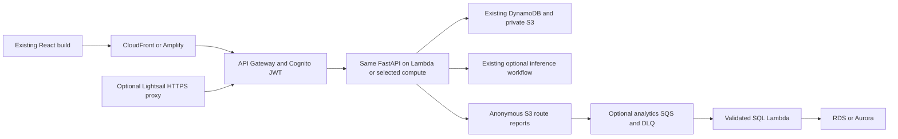
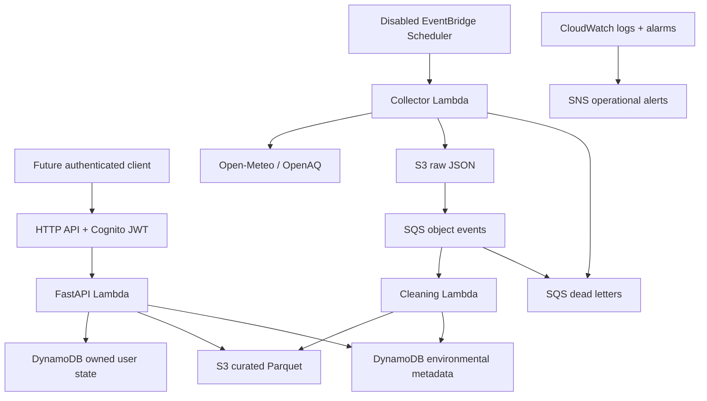

# EcoRoute AI architecture — Phases 1–7

## Collector result verification - 2026-10-11

Existing S3->SQS->cleaner chain remains the intended flow. Raw collector save is verified; curation is not. No direct cleaning bypass used to manufacture an end-to-end success. Narrow diagnostic policy is prepared, not applied.

## Activation walkthrough - 2026-10-11

AWS_ROUTE_AIR_SETUP.md explains existing dataflow activation and hosted-vs-local configuration.
Current air display derives selected-route concentration; it is not an AQI product. Pollution
collection is not automatically global for every user-selected origin. Runtime design unchanged.

## Verified Core update - 2026-10-11

Core UPDATE_COMPLETE, Data no changes. Live Google driving/walking and ORS cycling returned200
with real geometry and Open-Meteo weather; cycling elevation and driving traffic metadata verified.
PM2.5 coverage0/full exposure null: no pollution improvement claimed. Backend health/OpenAPI200,
private ML endpoints401 without token. Amplify200/served bundle contains route preferences and
actual local training evidence. No SageMaker job or endpoint. Optional ML role reuse/name changes
and bounded operator/workflow-boundary permission proposals remain defined, not deployed.
See latest PROJECT_STATE.md and LARGE_DATA_TRAINING.md for exact evidence/blockers.

## Route factors and large-data experiments - 2026-10-11

Real provider road geometry + deterministic exposure remain the engine. Traffic is part of driving
duration. Optional weather preferences and ORS modeled cycling ascent extend ranking; missing
weighted inputs block balanced selection. Protected /routes/predict returns full geometry with
approved one-hour station forecasts, otherwise separately labeled provider data or unavailable.
Foreign/synthetic data cannot be promoted by training, selection or cloud publication. Local UCI
experiment trained on 420,768 real Beijing rows; not navigation-eligible. See ROUTE_FACTORS.md and
LARGE_DATA_TRAINING.md. No endpoint, paid training or new idle infrastructure was created.

## Cognito registration and hosted Maps - 2026-10-11

Public Cognito self-registration requested and enabled through CDK context enable_self_signup; confirmation email code before login, strong password and PKCE retained. Browser maps need independent referrer-restricted frontend key, not runtime secret. Public signup form verified, no account registration performed.

## Live setup/test prerequisites - 2026-10-11

Added bounded verification harness for existing flow only; no new service. Private authentication awaits Cognito user creation; collector InvokeFunction denied until scoped policy attached.

## Provider secrets connected — 2026-10-11

Guest request-only route preview now enabled with real Google/ORS providers and budgets; personal routes/wearables still JWT-protected. Secret-specific Lambda roles connected; no persisted pollution yet verified. No Gemini claims beyond configuration.

## Uniform API key secret format — 2026-10-11

Backend routing secret reader normalizes Console api_key JSON and legacy plaintext; schema errors sanitized. Change pending Lambda deployment.

## Core live verification — 2026-10-11

Core deployed with exact Amplify origin and callback; public routes explicitly clear inherited JWT scopes. Private routes remain protected. Backend foundation verified live, domain providers unconfigured. See AMPLIFY_CONNECTION.md.

## Mapping cleanup correction — 2026-10-11

Core rollback recovery blocked on Lambda mapping deletion; regional deployment-role correction prepared. No live Core runtime verified.

Latest: logging provisioning progressed; workflow name now explicit within IAM project scope.
Core rollback failed on mapping read authorization. No operational Core runtime verified.

Latest deployment blocker is HTTP API access-log delivery permission; authentication/tagging
configuration progressed. Logging remains configured, not verified operational. Data/ML/IoT
unchanged; Core runtime unavailable pending bootstrap correction.

Latest cloud retry: Cognito MFA permission fixed; API Gateway stage handler tagging denied.
Prepared scoped bootstrap policy correction; runtime not deployed/verified. No API changes.

Follow-up: IoT stack now CREATE_COMPLETE, rule disabled in deployed template; no certificates,
devices or live telemetry tested. Core still blocked by pending Cognito policy update.

Deployment evidence 2026-10-11: environmental storage/queues and ML role/artifact/ECR preparation
are deployed. Core runtime is not verified (Cognito configuration denial/rollback); CloudFront
blocked by AWS account verification. Definitions do not imply working ingestion/authentication.
See PROJECT_STATE.md for resource statuses and the next scoped bootstrap policy correction.
IoT rule creation also denied; explicit project-scoped name added for retry. No live wearable
pipeline is verified. No provider keys or health records were uploaded during provisioning.

## Private local Health Connect extension — 2026-10-11

Existing Wearable sidebar -> authenticated loopback FastAPI phone-bridge GETs -> fixed-target
private Android HTTP API -> normalized in-memory records/summary -> existing watch plus eight
metric rows. Fresh root reads use days1–30; explicit phone-cache reads cannot establish daily
totals. Owner binding and session consent apply before phone calls. An expiring local read-only
key permits this specific bridge while Cognito is deferred; it does not bypass existing JWT
APIs. Cognito ecoroute/read can later access the configured owning user's local bridge.
No S3/DynamoDB/cloud resource or permanent health storage is used. AWS profile rejects LAN
configuration. Browser time zone defines calendar days; missing data stays unavailable.
See [HEALTH_CONNECT.md](HEALTH_CONNECT.md) for trust boundaries and normalization limitations.

Scoped bootstrap (2026-10-11): [AWS_CONSOLE_BOOTSTRAP.md](AWS_CONSOLE_BOOTSTRAP.md) connects an
authorized Console operator to the existing CDK app through constrained publishing/deployment
roles, four execution policies and an enforced application-role permissions boundary. All12
roles in the selected five-stack synthesis carry that exact-account boundary. Developer may
assume publishing/deploy/limited-lookup roles, not the CloudFormation execution role directly.
Runtime identities retain narrower per-resource CDK policies; the boundary is only their maximum.
Current bootstrap/app resources remain absent; user reports budget creation only. No new API or
frontend feature is introduced by this infrastructure preparation.

Deployment assessment update (2026-10-11): EcoRouteReadiness is attached; metadata reads confirm
the selected serverless Data/Core/ML/IoT/Hosting stacks and bootstrap are absent. Architecture
definitions are unchanged. No service was provisioned by verification. SageMaker training-job
quota0 blocks training, not defining its execution role; billing and reviewed deployment IAM
remain separate prerequisite gates. This update changes only diagnostics/documentation/tests.

## Selectable service integration — 2026-10-10

The Lambda default remains unchanged. Optional ComputeStack deploys the same FastAPI image
using Core Cognito, data environment and API permissions on ECS/Fargate, EC2, EKS or eligible
App Runner. Gateway can hand off to a verified HTTPS origin while retaining read/write JWT
scopes and forwarding the request path. EKS uses Pod Identity; its app apply/HTTPS ingress
are explicit operator prerequisites. Lightsail is a credential-free HTTPS proxy to Gateway.
HostingStack serves the existing Vite build through private S3/OAC CloudFront with optional
Route 53 aliases, or manual Amplify hosting. No frontend/navigation changes are made here.

Optional AnalyticsStack consumes the route engine's existing anonymous S3 reports through
its own encrypted SQS/DLQ and validation Lambda into either RDS PostgreSQL (isolated VPC,
TLS verify-full, secret endpoint, no NAT) or Aurora PostgreSQL Data API (bounded 0.5–1 ACU).
It never replaces owned DynamoDB records, stores health data or archives Google responses.
Writer secret/user is separate from generated DB admin; schema initialization is an operator
step. New ECS/EC2/SQL alarms reuse Core's unsubscribed operational SNS topic.
See MULTISERVICE_INTEGRATION.md for costs and the full configure/deploy/verify sequence.
All resources in this update are defined locally, not deployed or live-verified.

Frontend addition authorized after Phase7: React/TypeScript static SPA + lazy Three.js scene.
Historical mode imports an actual public-landmark response. Live mode uses memory-only Cognito
access token after PKCE and calls the existing REST API; it never falls back to recorded data.
The 3D city is illustrative; separate route view projects true returned GeoJSON. Exact frontend
origins configure Gateway and Lambda CORS. No new hosting, paid services or unauthenticated APIs.

Phase7 integration: one FastAPI app exposes42 versioned operations with Cognito JWT/owner scope;
ingestion supplies the same curated environmental repository to routing, station ML and wearable
correlation. ML/wearable dependencies are injectable so offline demos use one selected dataset.
Grounded explanations read stored route metrics; deterministic daily alerts use validated data;
schools reuse routing/forecast evaluation. Optional workflows call these services, not disconnected
demo components. No frontend/event subscription protocol is implemented.

Runtime remains Lambda/Mangum + API Gateway, avoiding idle ECS/NAT costs. Numerical inference
uses the existing optional load-on-demand worker; no always-on model endpoint. Defaults disable
schedules, IoT rules, Bedrock/SMS. Real routes verified with OSRM fallback only; Location templates
and SDK tests do not prove live AWS access. Full status and data limitations: DEMO_READINESS.md.
OpenAPI is generated from the app and checked for drift; contracts retain estimated/observed/
unavailable provenance and null exposure for incomplete coverage. No artificial gap filling.

Phase5: authenticated companion HTTPS or optional enrolled mTLS IoT publish -> validation ->
owned consent/device/event records in new on-demand wearable table -> filtered DynamoDB stream
-> consent-rechecking archive Lambda -> private wearables/* history in existing S3 bucket.
Owned journey correlation reuses route geometry and actual environmental index. No heart-rate
causation, dose or stress inference. Default rule disabled; no Thing/certificate/hardware enrolled.
Separate archive/validator IAM, encryption/TTL/deletion, adapter and optional transport decisions
are detailed in WEARABLES.md. Mobile HTTPS uses existing Cognito JWT; SigV4 WebSockets with
Identity Pool temporary credentials is evaluated but deferred. No frontend/mobile app.

Phase 4 (2026-10-10): existing measured curated Parquet -> availability-aware station features
-> versioned chronological train/validation/test datasets -> local or SageMaker BYOC training
-> validation-selected RF/HGB -> persistence comparisons on held-out test -> verified S3 model
manifest registry -> optional load-on-demand container Lambda -> authenticated FastAPI ML APIs.
The route engine joins next-hour station predictions by space/time and preserves grid fallback
provenance. It does not stretch the model horizon or claim street-level accuracy.

ML_WORKFLOW.md documents the optional Step Functions validate/train.sync/verify-publish flow,
disabled weekly Scheduler, roles, S3 layout, container contracts and inference alternatives.
Default synthesis creates no training job or real-time endpoint. Core remains a lean ZIP Lambda;
heavy numerical dependencies live in the optional ML container. No Fargate/NAT is introduced.
Registry metadata in S3 avoids an additional Model Registry/table requirement for this hackathon.
Five actual OpenAQ measurements were ingested locally after confirmed rotation; this small
late-retrieved collection still fails the training gate. No measured training dataset or model
currently passes; weather ingestion and
validated prediction intervals remain unavailable. Synthetic tests verify mechanics only.

Decision date: 2026-10-08. Delhi; AWS target ap-south-1 (Mumbai). Infrastructure is implemented
and synthesized, not deployed. See INGESTION.md and API_CONTRACT.md for the working contracts.

Phase 3 (2026-10-09): API -> Routes V2/Places V2 -> validated road geometry -> distance segments
-> existing curated environmental index -> exposure scoring -> owned route metadata/S3 results.
ROUTING.md documents the implemented algorithm, limits and fallback. AWS live calls are denied
for selected IAM user devesh_eco (CLI profile dev-admin); recorded OSRM tests do not imply AWS success.
Core optionally enables Location IAM; no additional always-on service or database is needed.

## Execution profiles and implemented workflow

LOCAL: FastAPI on loopback; SQLite for owned journeys/preferences/idempotency; local object
files + SQLite for environmental metadata. Provider adapters use real HTTP only through an
explicit ingestion command. Tests inject synthetic contract fixtures and botocore Stubber.
Missing real data never falls back to invented readings. Local SQLite is not a DynamoDB emulator.

AWS: API Gateway HTTP API -> Cognito JWT scopes -> FastAPI/Mangum Lambda. API handlers verify
JWT signature, issuer, client, access-token type and scopes again. Stored personal records use
the verified subject, consent and expiry enforcement. Production CORS requires explicit HTTPS
origins. No frontend exists; /docs is developer documentation.

Data stack owns seven on-demand tables, private data bucket, processing queue/DLQ and notification
wiring. Core owns API/Cognito, three business Lambdas plus wearable archive, disabled schedule, alarms and SNS.
ML stack owns only datasets/models storage: no training job, endpoint or model accuracy claim.
Phase5 optional IoT stack supersedes the old demo Thing/policy placeholder with a disabled
broker-envelope rule and validator. Exact device policy/enrollment plans are generated offline,
not automatic certificates. No working physical device or cloud integration is claimed.
SNS email subscription is a deployment prerequisite.

S3 lifecycle: raw30d, curated90d, general reports30d, route reports/geometry7d, datasets90d,
models180d; buckets retained on teardown. Route metadata7d, route cache reuse5min; physical
TTL/lifecycle cleanup is asynchronous. Routes and cache metadata reuse route_metadata table.
DynamoDB TTL is enforced on reads as well as scheduled deletion; personal journeys/telemetry7d,
idempotency1d, preferences90d. Tables retain data on stack removal with deletion protection.
Raw environmental data contains station/model locations, not personal wearable paths.

CDK creates an additional S3-notification custom-resource Lambda in Data; its deployment role
is separate from business runtime roles. Its generated managed logging policy is broader than
the business policies. Review the synthesized helper role and CloudFormation execution boundary
before deployment; do not claim every generated deployment permission is resource-exact.
No NAT/VPC/ECS/RDS/Bedrock/SageMaker endpoint is provisioned. Bounded Location authorization
probes were sent and denied; no successful AWS road data was obtained.

The spatial pipeline is now implemented within the bounds in ROUTING.md. ML training and real
hardware integration remain future work; no model or wearable integration is claimed.

## Lambda versus Fargate

Lambda fits intermittent hackathon traffic, short route ranking and no persistent processes.
Design target: under 10 seconds at p95 (unmeasured), 28-second API Lambda timeout, bounded
provider retries and small payloads. HTTP API integration has a 30-second maximum; Lambda's
900-second function ceiling does not extend that. Keep API bodies under 256 KiB; large results
go to S3 because Lambda synchronous payload limits and envelope overhead also apply.
Long forecasts return job IDs and run outside the request path.

Reconsider ECS Fargate only after profiling proves native geospatial dependencies exceed
Lambda packaging/memory limits, requests require continuous computation, or sustained usage
makes containers cheaper. Include ALB, public IPv4, image storage and networking in that review.
Fargate is not deployed merely because FastAPI can run in a container.

## Spatial data and route ranking

1. Retrieve provider-generated alternatives via boto3 `geo-routes.calculate_routes`, with
   Origin and Destination in **[longitude, latitude]**, requested travel mode and departure time.
   Ask for bounded alternatives; the provider may return fewer than requested.
2. Decode the returned route geometry and sample segments in meters using geodesic distance
   or a suitable projected CRS. Store source coordinates as WGS84; do not treat degrees as meters.
3. Join observations/forecast cells at estimated segment arrival times. Preserve pollutant,
   units, observed_at, received_at, source, station/cell, quality flags, spatial distance,
   averaging period, model version and uncertainty where available.
4. Rank only candidate routes actually returned. The product does not compute a globally
   pollution-optimal path over the whole road network. Bound detours and expose travel-time tradeoffs.
5. For PM2.5, concentration-time exposure is sum(C_i * delta_t_i), in **ug*h/m3** with duration
   converted from seconds to hours. This is **not inhaled dose** without
   validated ventilation data. Do not infer a medical risk score from heart rate or SpO2.
6. Do not integrate AQI numbers as if they were concentrations. If an Indian AQI view is added,
   verify the chosen standard's pollutant breakpoints and averaging windows before implementation.

Sparse Delhi stations do not establish street-level truth. The next credential-enabled integration must audit station coverage,
recency, units, provider licenses and missingness. Define maximum age and spatial radius from
that audit, then expose data coverage and unknown sections. Never fill unknown pollution with
zero or label the result "safe". A route can remain navigable while pollution ranking is unavailable.

PostGIS is deferred. Initial queries use bounded city/time partitions and a cell index;
DynamoDB is not a spatial SQL engine. Add PostgreSQL/PostGIS when measured radius/polygon joins
or network analysis justify GiST indexes and ST_DWithin. Prototype in Docker first; managed RDS
requires a separate cost/security decision, private networking and connection management.

## Storage, events and reliability

Implemented object layouts, metadata access patterns, idempotency, request budgets, bounded
backfill and limitations are specified in INGESTION.md. DynamoDB metadata partitions include
FILES#source, STATIONS#openaq, QUALITY#source, CACHE#source and BUDGET#source. No table scans.
The API reads bounded objects; a complete large export is a separate future workflow.

## ML plan (no trained model exists)

Start with persistence and seasonal/hour-of-week baselines on measured PM2.5. Candidate next
model: a tabular gradient boosting regressor with lagged pollutant readings, calendar features
and weather available at prediction time. Train locally first. Partition by time and hold out
stations; perform rolling-origin evaluation at 1h/3h/6h horizons. Fit preprocessing only on
training folds. No future observed weather or random row splits across autocorrelated series.
Report MAE/RMSE, baseline comparison, horizon/station breakdown, missing-data rate and interval
coverage if intervals are calibrated. Publish no accuracy claim without reproducible held-out results.
Record source checksums, cutoff time, features, hyperparameters, package lock, metrics and model
card. SageMaker AI later runs bounded training/batch inference with a maximum runtime and explicit
instance quota approval; no always-on endpoint or Studio domain by default. Step Functions becomes
useful when validate/train/evaluate/publish needs durable orchestration, not for a single handler.
Bedrock is optional for a grounded textual explanation of computed numbers; it cannot invent
concentrations, override ranking or serve as the forecasting engine.

## Identity, privacy and wearable gate

Cognito authorization-code + PKCE is the future public-client flow; no mobile client secret.
Use access tokens with route scopes and issuer/audience/token-use validation. JWT checks and
object authorization must be implemented before any user-data route becomes public. No unauthenticated
Lambda function URL, permissive CORS, raw request-body logs or broad runtime IAM. Use TLS, short
sessions and separate developer, deployment and workload roles. Three people sharing one laptop
should use separate OS accounts/SSO profiles; do not share browser sessions, GitHub tokens or keys.

User confirmed Noise ColorFit Pro3 Alpha with NoiseFit Assist in Phase5. Official
support pages confirm companion-app syncing. Watch OS remains unknown; no public
developer API, direct MQTT support, export format or reliable background GPS integration was
verified. Do not extract private app tokens or promise a working integration. Verify exact model,
phone OS and companion-app version on-device. Phase 1 can define a consented timestamped import
contract; a phone Health Connect/HealthKit bridge is a later option only if actual exports are
supported. No frontend or mobile bridge is built in this phase. IoT Core is for a separately
supported device/gateway with its own certificate; it is not a workaround for inaccessible watch data.

## Delivery boundaries

Phase 1 foundation and Phase 2 ingestion are locally implemented. Phase 3 adds bounded routing,
scoring and authenticated persistence. Deployment, successful AWS route verification, measured
station coverage, trained forecasting and wearable integration remain gated work. Every phase
updates the five required living documents. No deployment is implied by local implementation.
# Phase 6 architecture extension

Existing FastAPI/Cognito JWT boundary now includes advisory APIs; no frontend. An owned route
lookup supplies sanitized numeric facts and approved statements to optional Bedrock Converse.
The model selects statement order only; deterministic rendering/ranking/threshold rules stay
authoritative. Missing permissions/model returns fallback. No health/GPS/provider prose is sent.

Private school records use the existing preference table; alert/window claims, notification
cooldown and workflow manifests reuse the alert table. SQLite/Dynamo adapters support atomic
claims and bounded owner queries with TTL/truncation. SNS uses dedicated operator-bound
single-recipient topics, explicit opt-in and verified SMS destinations, never public health data.

Optional inactive workflow: daily Scheduler -> encrypted SQS -> gated Lambda dispatcher ->
Standard Step Functions -> ingestion + synchronous existing curation -> optional verified
one-hour station inference -> daily provider-forecast risk -> alerts -> optional SMS. No model
extrapolation into unsupported daily horizons. Exceptions reach a dedicated DLQ; no task retries.
CloudWatch failure/error/DLQ/alert-volume alarms and structured EMF counts exclude identities.

Daily advisories require complete 24-hour evidence; Open-Meteo sample means retain coarse-grid
and approximation labels. Next-day school window is UTC-hour aligned before India midnight,
not a midnight calendar-day average. No legal closure/diagnosis/precise roadside claim.
Definitions are local-only, schedule DISABLED, dispatcher gate false, live Bedrock/SMS false.
See [Phase6 runbook](PHASE6_ADVISORIES.md) for security boundaries, permissions and costs.

### Cinematic visual asset (2026-10-10)
The frontend serves a bundled AI-generated city image locally. Pan/zoom is a presentation effect;
real-time Three.js geometry is a separately selected mode, lazily mounted. Route geometry and all
backend API contracts remain unchanged. No image generation service is called by the running app.

### Unified animated city (supersedes separate modes)
The old procedural 3D UI and Three.js were removed at the user's request. City view now
composites architectural artwork, moving transparent train sprites and reflections into a single
2.5D scene. There is no orbit mode. Route view and all existing backend contracts are preserved.

## Google routing integration (2026-10-10)
See docs/GOOGLE_MAPS_SETUP.md (repository root) for separate server/browser keys, APIs, Cognito,
restricted secret IAM and verification. Google Routes/Places feed the existing exposure engine;
Journeys displays Maps JavaScript tiles and route overlays. Live provider verification is recorded below.
Google comparisons are request-only; saved route-ID workflows are unavailable for those results.
No AWS resources were deployed. Google charges are separate from AWS credits.

Original wearable preview: lazily loaded Three.js/Fiber procedural model with a canvas-textured
screen, plus accessible React controls and static fallback. Tailwind utilities are prefixed and
Preflight is omitted. The demo is isolated from backend telemetry and does not modify consent.
See CUSTOM_WATCH.md for data boundaries, performance and verification.

## Public map and travel modes — 2026-10-10

Public Google Maps now opens by default when the browser key exists. Guest POST /routes/preview is a separate request-only comparison path; existing owned/location/health APIs remain Cognito-protected. Backend Google Drive/Walk routes and optional ORS cycling feed the existing exposure engine. Live pollution remains unavailable unless genuine curated data covers the departure. ORS/Google content is not saved in this profile. Infrastructure guest access is opt-in; no AWS deployment was performed.

## User-selected locations and live wiring — 2026-10-11

Google mode routing validates worldwide WGS84 coordinates and uses unbiased Places text searches;
it no longer applies the Delhi-only boundary. Legacy AWS/OSRM profiles retain their existing scope.
Existing limits of 100km, six hours and bounded provider request budgets remain enforced.
Live origin/destination start empty. A neutral world viewport contains no invented pins. Map picks
and explicit browser geolocation feed named latitude/longitude inputs; results retain GeoJSON
[longitude,latitude]. My location requests permission only when clicked. Missing coverage stays null.

Server-only Google/ORS keys reside in the ignored root .env; the frontend .env.local holds the
restricted browser key and public API URL. A malformed local API URL was corrected and URL validation
now rejects invalid protocols, embedded credentials and query/hash settings before networking.
No authentication bypass was added to private endpoints. Real Google Drive/Walk, ORS Cycle and
Mumbai Places were verified; one full guest browser comparison returned three road routes and two
pins. Provider content remains request-only; no AWS resources were created or invoked in this change.

## Browser wearable adapter — 2026-10-11

An opt-in Web Bluetooth adapter uses only standard Heart Rate notifications and optional Battery
reads. Measurements and up to 60 BPM trend samples stay in the current tab's memory; no anonymous
health endpoint, persistent browser store or cloud upload is introduced. Browser consent, device
chooser, scope-limited GATT access, validated packets, freshness and disconnect cleanup apply.
Partial values render on the existing 3D watch; unavailable fields and inferred health scores are
never filled. The graph is a received BPM trend, not ECG. Backend latest readings map through a
separate non-synthetic adapter after existing Cognito ownership/consent validation; they are manual
snapshots, not a phone stream. API/storage/IAM definitions remain unchanged.

Actual ADB/nRF inspection verified authorized USB and vendor notifications, not health semantics.
Noise 0x0AF0/0x0AF7 lacks a verified decoder; its bridge remains blocked. See LIVE_WATCH_SETUP.md.

## Gemini and small-account AWS deployment — 2026-10-11

Latest deployment plan retains SageMaker for measured-data forecasting, with Gemini as the
optional explanation provider instead of Bedrock. Both cannot be enabled together. The same
owned-route API uses sanitized calculated metrics and model-selected approved statement IDs;
free model prose cannot reach the response or change scores. Guest Google request-only Insights
remains deterministic. Gemini is external to AWS; server-only keys/Secret Manager references
are separate from AWS identity. No browser key, health data or place text goes to Gemini.

CDK default Lambda functions use the account's unreserved pool because live quota10 cannot
support the former reservations; profile opt-in requires a reviewed increased quota. SQS/API
throttles and DDB caps remain; removing reservations is not a per-function spend cap.
ML defines an immutable ECR training repository and narrowly scoped SageMaker training role
before an image exists. A reviewed digest enables the existing validation/train/publish workflow
and Lambda inference; neither deployment nor a role implies trained data/models. Actual local
eligible sample count is zero. CloudFront serves the existing frontend through private S3/OAC;
other runtimes/SQL/Amplify stay alternatives. No new deployment or paid job was performed.
See [current AWS runbook](AWS_READINESS_AND_GEMINI.md).
