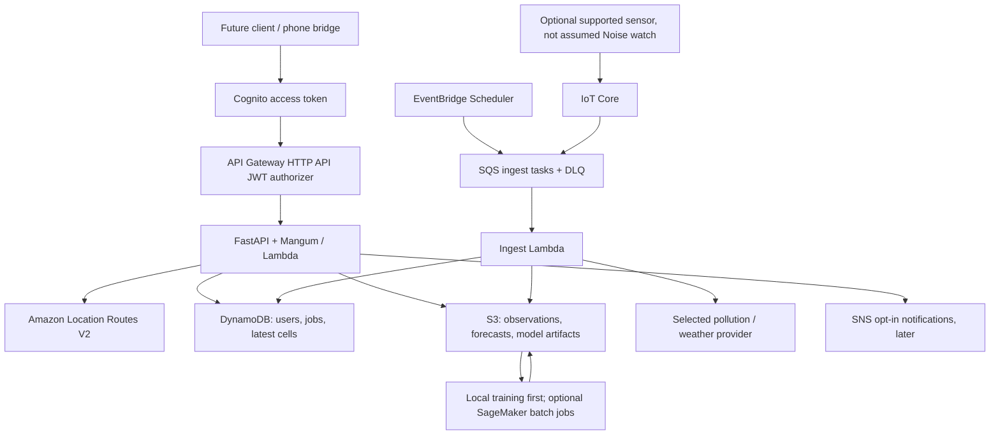

# EcoRoute AI architecture — Phase 0

Decision date: 2026-10-08. Target: Delhi, India. Primary region: ap-south-1 (Mumbai).
These are design decisions, not deployed integrations. See VERIFIED_SOURCES.md for evidence.

## Scope and profiles

LOCAL runs Python FastAPI on loopback. Phase 0 implements /healthz only. Phase 1 will add
provider interfaces with recorded/synthetic fixtures explicitly marked as such, local files
for objects and SQLite for application state. SQLite is an adapter, not an emulation of
DynamoDB transactions/TTL. Later use botocore Stubber and AWS integration tests separately.
Each real adapter requires an explicit feature flag, prerequisite validation and an approved
spending envelope. No automatic fallback from an unavailable real provider to fake observations.

AWS will run the same FastAPI business layer through Mangum on Lambda behind API Gateway
HTTP API. REST-style resources do not require API Gateway's more expensive REST API product.
Separate Lambda handlers handle ingest and events. No VPC is needed initially; this avoids NAT
Gateway baseline cost. Runtime packages must be built for Lambda Linux, not copied from Windows.

Diagram is the target architecture. Phase 0 contains none of these cloud resources.

## Lambda versus Fargate

Lambda fits intermittent hackathon traffic, short route ranking and no persistent processes.
Design target: under 10 seconds at p95 (unmeasured), 20-second application deadline, bounded
provider retries and small payloads. HTTP API integration has a 30-second maximum; Lambda's
900-second function ceiling does not extend that. Keep API bodies under 256 KiB; large results
go to S3 because Lambda synchronous payload limits and envelope overhead also apply.
Long forecasts return job IDs and run outside the request path.

Reconsider ECS Fargate only after profiling proves native geospatial dependencies exceed
Lambda packaging/memory limits, requests require continuous computation, or sustained usage
makes containers cheaper. Include ALB, public IPv4, image storage and networking in that review.
Fargate is not deployed merely because FastAPI can run in a container.

## Spatial data and route ranking

1. Retrieve provider-generated alternatives via boto3 `geo-routes.calculate_routes`, with
   Origin and Destination in **[longitude, latitude]**, requested travel mode and departure time.
   Ask for bounded alternatives; the provider may return fewer than requested.
2. Decode the returned route geometry and sample segments in meters using geodesic distance
   or a suitable projected CRS. Store source coordinates as WGS84; do not treat degrees as meters.
3. Join observations/forecast cells at estimated segment arrival times. Preserve pollutant,
   units, observed_at, received_at, source, station/cell, quality flags, spatial distance,
   averaging period, model version and uncertainty where available.
4. Rank only candidate routes actually returned. The product does not compute a globally
   pollution-optimal path over the whole road network. Bound detours and expose travel-time tradeoffs.
5. For PM2.5, concentration-time exposure is sum(C_i * delta_t_i), in microgram-minute/m3.
   Time-weighted concentration divides by total minutes. This is **not inhaled dose** without
   validated ventilation data. Do not infer a medical risk score from heart rate or SpO2.
6. Do not integrate AQI numbers as if they were concentrations. If an Indian AQI view is added,
   verify the chosen standard's pollutant breakpoints and averaging windows before implementation.

Sparse Delhi stations do not establish street-level truth. Phase 1 must audit station coverage,
recency, units, provider licenses and missingness. Define maximum age and spatial radius from
that audit, then expose data coverage and unknown sections. Never fill unknown pollution with
zero or label the result "safe". A route can remain navigable while pollution ranking is unavailable.

PostGIS is deferred. Initial queries use bounded city/time partitions and a cell index;
DynamoDB is not a spatial SQL engine. Add PostgreSQL/PostGIS when measured radius/polygon joins
or network analysis justify GiST indexes and ST_DWithin. Prototype in Docker first; managed RDS
requires a separate cost/security decision, private networking and connection management.

## Storage, events and reliability

- S3 prefixes: raw/provider/date, curated/city/pollutant/date, models/version, forecasts/version.
  Preserve data lineage and license metadata. Block public access, enforce TLS and encryption.
- DynamoDB access patterns: USER#subject / SESSION#id; SESSION#id / timestamp#event_id;
  CELL#city#cell / pollutant#valid_time; JOB#id / META. Query bounded time ranges, never table scans
  on the request path. Large geometry/time series belong in S3. Application ownership checks
  use verified token subject, never a client-supplied user ID.
- Scheduler creates polling tasks, not arbitrary external requests. SQS absorbs provider delay.
  Use provider+station+pollutant+timestamp as observation idempotency key, conditional writes,
  retries with jitter, partial-batch failure handling and a DLQ. Set visibility timeout to at
  least six times handler timeout plus batching window before deployment.
- Forecast publish: write immutable artifact, validate, then conditionally update active pointer.
  API must reject stale versions beyond policy and explicitly report missing coverage.
- Suggested retention, pending consent: precise trip/device events 7 days, aggregates 30 days,
  logs 7 days; public observations as license permits. TTL is asynchronous; enforce expiry on
  reads. User deletion must cover DynamoDB, S3 versions and any retained backups by documented policy.

## ML plan (no trained model exists)

Start with persistence and seasonal/hour-of-week baselines on measured PM2.5. Candidate next
model: a tabular gradient boosting regressor with lagged pollutant readings, calendar features
and weather available at prediction time. Train locally first. Partition by time and hold out
stations; perform rolling-origin evaluation at 1h/3h/6h horizons. Fit preprocessing only on
training folds. No future observed weather or random row splits across autocorrelated series.
Report MAE/RMSE, baseline comparison, horizon/station breakdown, missing-data rate and interval
coverage if intervals are calibrated. Publish no accuracy claim without reproducible held-out results.
Record source checksums, cutoff time, features, hyperparameters, package lock, metrics and model
card. SageMaker AI later runs bounded training/batch inference with a maximum runtime and explicit
instance quota approval; no always-on endpoint or Studio domain by default. Step Functions becomes
useful when validate/train/evaluate/publish needs durable orchestration, not for a single handler.
Bedrock is optional for a grounded textual explanation of computed numbers; it cannot invent
concentrations, override ranking or serve as the forecasting engine.

## Identity, privacy and wearable gate

Cognito authorization-code + PKCE is the future public-client flow; no mobile client secret.
Use access tokens with route scopes and issuer/audience/token-use validation. JWT checks and
object authorization must be implemented before any user-data route becomes public. No unauthenticated
Lambda function URL, permissive CORS, raw request-body logs or broad runtime IAM. Use TLS, short
sessions and separate developer, deployment and workload roles. Three people sharing one laptop
should use separate OS accounts/SSO profiles; do not share browser sessions, GitHub tokens or keys.

User reports a Noise Pro 3 Alpha, interpreted provisionally as ColorFit Pro 3 Alpha. Official
support pages refer to phone-app syncing and are inconsistent about app naming. No public
developer API, direct MQTT support, export format or reliable background GPS integration was
verified. Do not extract private app tokens or promise a working integration. Verify exact model,
phone OS and companion-app version on-device. Phase 1 can define a consented timestamped import
contract; a phone Health Connect/HealthKit bridge is a later option only if actual exports are
supported. No frontend or mobile bridge is built in this phase. IoT Core is for a separately
supported device/gateway with its own certificate; it is not a workaround for inaccessible watch data.

## Delivery boundaries

Phase 1: local provider contracts, route validation, honest fixtures, Delhi coverage audit,
pollution ranking tests and initial baseline pipeline. Phase 2: individually enabled real reads
after credentials/cost approval. Phase 3: scoped CDK infrastructure, auth and integration tests,
budget alerts, deployment approval, deployment and teardown verification. Phase 4: validated
forecasting and optional wearables. Every phase updates the five required living documents.
