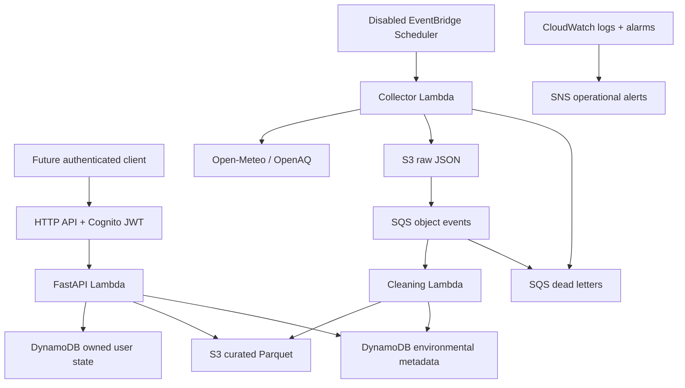

# EcoRoute AI architecture — Phases 1–7

Phase7 integration: one FastAPI app exposes42 versioned operations with Cognito JWT/owner scope;
ingestion supplies the same curated environmental repository to routing, station ML and wearable
correlation. ML/wearable dependencies are injectable so offline demos use one selected dataset.
Grounded explanations read stored route metrics; deterministic daily alerts use validated data;
schools reuse routing/forecast evaluation. Optional workflows call these services, not disconnected
demo components. No frontend/event subscription protocol is implemented.

Runtime remains Lambda/Mangum + API Gateway, avoiding idle ECS/NAT costs. Numerical inference
uses the existing optional load-on-demand worker; no always-on model endpoint. Defaults disable
schedules, IoT rules, Bedrock/SMS. Real routes verified with OSRM fallback only; Location templates
and SDK tests do not prove live AWS access. Full status and data limitations: DEMO_READINESS.md.
OpenAPI is generated from the app and checked for drift; contracts retain estimated/observed/
unavailable provenance and null exposure for incomplete coverage. No artificial gap filling.

Phase5: authenticated companion HTTPS or optional enrolled mTLS IoT publish -> validation ->
owned consent/device/event records in new on-demand wearable table -> filtered DynamoDB stream
-> consent-rechecking archive Lambda -> private wearables/* history in existing S3 bucket.
Owned journey correlation reuses route geometry and actual environmental index. No heart-rate
causation, dose or stress inference. Default rule disabled; no Thing/certificate/hardware enrolled.
Separate archive/validator IAM, encryption/TTL/deletion, adapter and optional transport decisions
are detailed in WEARABLES.md. Mobile HTTPS uses existing Cognito JWT; SigV4 WebSockets with
Identity Pool temporary credentials is evaluated but deferred. No frontend/mobile app.

Phase 4 (2026-10-10): existing measured curated Parquet -> availability-aware station features
-> versioned chronological train/validation/test datasets -> local or SageMaker BYOC training
-> validation-selected RF/HGB -> persistence comparisons on held-out test -> verified S3 model
manifest registry -> optional load-on-demand container Lambda -> authenticated FastAPI ML APIs.
The route engine joins next-hour station predictions by space/time and preserves grid fallback
provenance. It does not stretch the model horizon or claim street-level accuracy.

ML_WORKFLOW.md documents the optional Step Functions validate/train.sync/verify-publish flow,
disabled weekly Scheduler, roles, S3 layout, container contracts and inference alternatives.
Default synthesis creates no training job or real-time endpoint. Core remains a lean ZIP Lambda;
heavy numerical dependencies live in the optional ML container. No Fargate/NAT is introduced.
Registry metadata in S3 avoids an additional Model Registry/table requirement for this hackathon.
Five actual OpenAQ measurements were ingested locally after confirmed rotation; this small
late-retrieved collection still fails the training gate. No measured training dataset or model
currently passes; weather ingestion and
validated prediction intervals remain unavailable. Synthetic tests verify mechanics only.

Decision date: 2026-10-08. Delhi; AWS target ap-south-1 (Mumbai). Infrastructure is implemented
and synthesized, not deployed. See INGESTION.md and API_CONTRACT.md for the working contracts.

Phase 3 (2026-10-09): API -> Routes V2/Places V2 -> validated road geometry -> distance segments
-> existing curated environmental index -> exposure scoring -> owned route metadata/S3 results.
ROUTING.md documents the implemented algorithm, limits and fallback. AWS live calls are denied
for selected IAM user devesh_eco (CLI profile dev-admin); recorded OSRM tests do not imply AWS success.
Core optionally enables Location IAM; no additional always-on service or database is needed.

## Execution profiles and implemented workflow

LOCAL: FastAPI on loopback; SQLite for owned journeys/preferences/idempotency; local object
files + SQLite for environmental metadata. Provider adapters use real HTTP only through an
explicit ingestion command. Tests inject synthetic contract fixtures and botocore Stubber.
Missing real data never falls back to invented readings. Local SQLite is not a DynamoDB emulator.

AWS: API Gateway HTTP API -> Cognito JWT scopes -> FastAPI/Mangum Lambda. API handlers verify
JWT signature, issuer, client, access-token type and scopes again. Stored personal records use
the verified subject, consent and expiry enforcement. Production CORS requires explicit HTTPS
origins. No frontend exists; /docs is developer documentation.

Data stack owns seven on-demand tables, private data bucket, processing queue/DLQ and notification
wiring. Core owns API/Cognito, three business Lambdas plus wearable archive, disabled schedule, alarms and SNS.
ML stack owns only datasets/models storage: no training job, endpoint or model accuracy claim.
Phase5 optional IoT stack supersedes the old demo Thing/policy placeholder with a disabled
broker-envelope rule and validator. Exact device policy/enrollment plans are generated offline,
not automatic certificates. No working physical device or cloud integration is claimed.
SNS email subscription is a deployment prerequisite.

S3 lifecycle: raw30d, curated90d, general reports30d, route reports/geometry7d, datasets90d,
models180d; buckets retained on teardown. Route metadata7d, route cache reuse5min; physical
TTL/lifecycle cleanup is asynchronous. Routes and cache metadata reuse route_metadata table.
DynamoDB TTL is enforced on reads as well as scheduled deletion; personal journeys/telemetry7d,
idempotency1d, preferences90d. Tables retain data on stack removal with deletion protection.
Raw environmental data contains station/model locations, not personal wearable paths.

CDK creates an additional S3-notification custom-resource Lambda in Data; its deployment role
is separate from business runtime roles. Its generated managed logging policy is broader than
the business policies. Review the synthesized helper role and CloudFormation execution boundary
before deployment; do not claim every generated deployment permission is resource-exact.
No NAT/VPC/ECS/RDS/Bedrock/SageMaker endpoint is provisioned. Bounded Location authorization
probes were sent and denied; no successful AWS road data was obtained.

The spatial pipeline is now implemented within the bounds in ROUTING.md. ML training and real
hardware integration remain future work; no model or wearable integration is claimed.

## Lambda versus Fargate

Lambda fits intermittent hackathon traffic, short route ranking and no persistent processes.
Design target: under 10 seconds at p95 (unmeasured), 28-second API Lambda timeout, bounded
provider retries and small payloads. HTTP API integration has a 30-second maximum; Lambda's
900-second function ceiling does not extend that. Keep API bodies under 256 KiB; large results
go to S3 because Lambda synchronous payload limits and envelope overhead also apply.
Long forecasts return job IDs and run outside the request path.

Reconsider ECS Fargate only after profiling proves native geospatial dependencies exceed
Lambda packaging/memory limits, requests require continuous computation, or sustained usage
makes containers cheaper. Include ALB, public IPv4, image storage and networking in that review.
Fargate is not deployed merely because FastAPI can run in a container.

## Spatial data and route ranking

1. Retrieve provider-generated alternatives via boto3 `geo-routes.calculate_routes`, with
   Origin and Destination in **[longitude, latitude]**, requested travel mode and departure time.
   Ask for bounded alternatives; the provider may return fewer than requested.
2. Decode the returned route geometry and sample segments in meters using geodesic distance
   or a suitable projected CRS. Store source coordinates as WGS84; do not treat degrees as meters.
3. Join observations/forecast cells at estimated segment arrival times. Preserve pollutant,
   units, observed_at, received_at, source, station/cell, quality flags, spatial distance,
   averaging period, model version and uncertainty where available.
4. Rank only candidate routes actually returned. The product does not compute a globally
   pollution-optimal path over the whole road network. Bound detours and expose travel-time tradeoffs.
5. For PM2.5, concentration-time exposure is sum(C_i * delta_t_i), in **ug*h/m3** with duration
   converted from seconds to hours. This is **not inhaled dose** without
   validated ventilation data. Do not infer a medical risk score from heart rate or SpO2.
6. Do not integrate AQI numbers as if they were concentrations. If an Indian AQI view is added,
   verify the chosen standard's pollutant breakpoints and averaging windows before implementation.

Sparse Delhi stations do not establish street-level truth. The next credential-enabled integration must audit station coverage,
recency, units, provider licenses and missingness. Define maximum age and spatial radius from
that audit, then expose data coverage and unknown sections. Never fill unknown pollution with
zero or label the result "safe". A route can remain navigable while pollution ranking is unavailable.

PostGIS is deferred. Initial queries use bounded city/time partitions and a cell index;
DynamoDB is not a spatial SQL engine. Add PostgreSQL/PostGIS when measured radius/polygon joins
or network analysis justify GiST indexes and ST_DWithin. Prototype in Docker first; managed RDS
requires a separate cost/security decision, private networking and connection management.

## Storage, events and reliability

Implemented object layouts, metadata access patterns, idempotency, request budgets, bounded
backfill and limitations are specified in INGESTION.md. DynamoDB metadata partitions include
FILES#source, STATIONS#openaq, QUALITY#source, CACHE#source and BUDGET#source. No table scans.
The API reads bounded objects; a complete large export is a separate future workflow.

## ML plan (no trained model exists)

Start with persistence and seasonal/hour-of-week baselines on measured PM2.5. Candidate next
model: a tabular gradient boosting regressor with lagged pollutant readings, calendar features
and weather available at prediction time. Train locally first. Partition by time and hold out
stations; perform rolling-origin evaluation at 1h/3h/6h horizons. Fit preprocessing only on
training folds. No future observed weather or random row splits across autocorrelated series.
Report MAE/RMSE, baseline comparison, horizon/station breakdown, missing-data rate and interval
coverage if intervals are calibrated. Publish no accuracy claim without reproducible held-out results.
Record source checksums, cutoff time, features, hyperparameters, package lock, metrics and model
card. SageMaker AI later runs bounded training/batch inference with a maximum runtime and explicit
instance quota approval; no always-on endpoint or Studio domain by default. Step Functions becomes
useful when validate/train/evaluate/publish needs durable orchestration, not for a single handler.
Bedrock is optional for a grounded textual explanation of computed numbers; it cannot invent
concentrations, override ranking or serve as the forecasting engine.

## Identity, privacy and wearable gate

Cognito authorization-code + PKCE is the future public-client flow; no mobile client secret.
Use access tokens with route scopes and issuer/audience/token-use validation. JWT checks and
object authorization must be implemented before any user-data route becomes public. No unauthenticated
Lambda function URL, permissive CORS, raw request-body logs or broad runtime IAM. Use TLS, short
sessions and separate developer, deployment and workload roles. Three people sharing one laptop
should use separate OS accounts/SSO profiles; do not share browser sessions, GitHub tokens or keys.

User confirmed Noise ColorFit Pro3 Alpha with NoiseFit Assist in Phase5. Official
support pages confirm companion-app syncing. Watch OS remains unknown; no public
developer API, direct MQTT support, export format or reliable background GPS integration was
verified. Do not extract private app tokens or promise a working integration. Verify exact model,
phone OS and companion-app version on-device. Phase 1 can define a consented timestamped import
contract; a phone Health Connect/HealthKit bridge is a later option only if actual exports are
supported. No frontend or mobile bridge is built in this phase. IoT Core is for a separately
supported device/gateway with its own certificate; it is not a workaround for inaccessible watch data.

## Delivery boundaries

Phase 1 foundation and Phase 2 ingestion are locally implemented. Phase 3 adds bounded routing,
scoring and authenticated persistence. Deployment, successful AWS route verification, measured
station coverage, trained forecasting and wearable integration remain gated work. Every phase
updates the five required living documents. No deployment is implied by local implementation.
# Phase 6 architecture extension

Existing FastAPI/Cognito JWT boundary now includes advisory APIs; no frontend. An owned route
lookup supplies sanitized numeric facts and approved statements to optional Bedrock Converse.
The model selects statement order only; deterministic rendering/ranking/threshold rules stay
authoritative. Missing permissions/model returns fallback. No health/GPS/provider prose is sent.

Private school records use the existing preference table; alert/window claims, notification
cooldown and workflow manifests reuse the alert table. SQLite/Dynamo adapters support atomic
claims and bounded owner queries with TTL/truncation. SNS uses dedicated operator-bound
single-recipient topics, explicit opt-in and verified SMS destinations, never public health data.

Optional inactive workflow: daily Scheduler -> encrypted SQS -> gated Lambda dispatcher ->
Standard Step Functions -> ingestion + synchronous existing curation -> optional verified
one-hour station inference -> daily provider-forecast risk -> alerts -> optional SMS. No model
extrapolation into unsupported daily horizons. Exceptions reach a dedicated DLQ; no task retries.
CloudWatch failure/error/DLQ/alert-volume alarms and structured EMF counts exclude identities.

Daily advisories require complete 24-hour evidence; Open-Meteo sample means retain coarse-grid
and approximation labels. Next-day school window is UTC-hour aligned before India midnight,
not a midnight calendar-day average. No legal closure/diagnosis/precise roadside claim.
Definitions are local-only, schedule DISABLED, dispatcher gate false, live Bedrock/SMS false.
See [Phase6 runbook](PHASE6_ADVISORIES.md) for security boundaries, permissions and costs.
