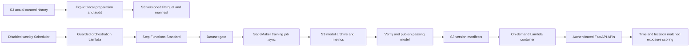

# Phase 4: station PM2.5 forecasting workflow

As of 2026-10-10 IST. Phases 1–3 were checked before starting: 107 tests, actual loopback
HTTP smoke and the previous GitHub CI passed. Cloud deployment, Cognito login and successful
Amazon Location access remain unresolved; local implementation is not cloud completion.
Phase 4 reuses curated environmental Parquet, the existing data bucket/index and routing engine.
No SageMaker job, real-time endpoint, processing instance, Studio domain or AWS resource has
been launched or deployed. No real model accuracy or baseline improvement is claimed.

## Real data result and scientific limits

`python scripts/train.py --prepare-only` inspected the actual local curated files:
192 input records, 76 modeled/116 forecast Open-Meteo values, **zero measured PM2.5 records,
zero station series and zero eligible supervised samples**. It exited2 with insufficient_data
and wrote work/ml/data_audit.json. No model or MAE/RMSE was generated from this data.
Forecast values are not relabelled as measurements. No actual S3 history exists in this project
because deployment/upload has not occurred. S3 input support is implemented, not claimed executed.

At least seven days of eligible hourly series and 72/24/24 aggregate train/validation/test
samples are required. Each supported station needs at least24 train,12 validation and12 test
examples. These are hackathon engineering gates, not sufficient evidence of seasonal robustness.
Collection should span substantially longer for a credible Delhi forecasting assessment.
No currently verified stations or calibrated prediction intervals are available.

Historical feature availability is conservative: both reported_at and collected_at must be
at or before issuance. A late backfill collected today cannot establish what was available at
an earlier historical issuance, so it cannot silently train a hindsight operational forecast.
Accumulate real retrieval vintages, or implement a separately audited provider availability/revision
history contract first. OpenAQ stale/flagged/unit-invalid/coordinate-drifting histories are excluded.
Do not remove those gates simply to produce a model for the hackathon.

## Local commands and outputs

Preserve the existing .env. Install the optional numerical stack separately; it is deliberately
excluded from the main API Lambda ZIP to stay within packaging limits.

```powershell
.\.venv\Scripts\python.exe -m pip install -r requirements-ml.txt
.\.venv\Scripts\python.exe scripts/train.py --prepare-only
# Once the data audit passes, default runs preparation + training + evaluation:
.\.venv\Scripts\python.exe scripts/train.py
# Re-evaluate the exported selected candidate against its exact dataset:
.\.venv\Scripts\python.exe scripts/evaluate.py --dataset work/ml/datasets/DATASET_VERSION --model-version MODEL_VERSION
.\.venv\Scripts\python.exe -m pytest -q
```

Versions: scikit-learn1.7.2, NumPy2.2.6, SciPy1.15.3, joblib1.5.2 and threadpoolctl3.6.0;
Python3.11. Windows wheel installation and local contract training were exercised. This is a
custom SageMaker-compatible image, rather than relying on an old managed framework image whose
package versions differ. Pin matching training/inference libraries; mismatches reject loading.
`Dockerfile.ml` includes the AWS Lambda Runtime Interface Client3.1.1 for the optional Lambda path.

The local C: drive initially had no free space. Recursive generated-output cleanup was rejected
by automatic review. The existing generated cdk.out was moved, with path checks, to
D:\CodexEcoRouteScratch\phase3-cdk.out; source and measured data were preserved. ML wheels/downloads
were installed under D:\CodexEcoRouteScratch\ml-deps and linked through this laptop's ignored
venv .pth file. This workaround is local machine state, not a repository dependency path.
Normal installations on a machine with space use the command above.

```text
datasets/<24-hex-version>/train.parquet
datasets/<version>/validation.parquet
datasets/<version>/test.parquet
datasets/<version>/manifest.json               # hashes, schema, counts, source eligibility, dates
models/<model-version>/model.joblib             # local trusted export
models/<model-version>/manifest.json            # algorithm, packages, feature schema, metrics
```

Default roots are work/ml/datasets and work/ml/models, ignored by Git. In AWS the corresponding
datasets prefix is in the existing ML bucket. SageMaker writes model.tar.gz under
models/training/<job>/output/. Verified publication writes models/registry/<version>/model.joblib
and manifest.json; S3 manifests are the version registry, avoiding another table/service.
No real dataset/model object was uploaded in Phase 4.

## Features, splits and evaluation

Only observed OpenAQ PM2.5 with normalized ug/m3, valid Delhi coordinates and clean quality
flags can supply labels. Series IDs combine station/location and sensor to avoid merging different
instruments. Station coordinates must remain stable. Samples use exact hourly valid timestamps;
missing target hours are dropped, never interpolated. Prediction horizon is one hour.

Features: latest available PM2.5; 1/2/3/24-hour lags; available past3/6-hour means; observation age;
station latitude/longitude; cyclical local Delhi hour/day-of-week. Lag availability uses original
retrieval times, so revisions or future records do not contaminate earlier samples. No neighbor
station interpolation is claimed; station coordinates are spatial features, not street coverage.
Station measurements are point proxies; their representativeness remains unvalidated.

Optional `--weather-json` accepts historical rows with available_at, reported_at, coordinates,
temperature_c, humidity_pct, wind_m_s and wind_direction_deg, using explicit normalized units.
Only weather available by issuance, no more than two hours old and geographically eligible is
joined. Future weather/issued forecasts cannot leak into past features. No real weather source
has been collected or integrated. Missing weather is fitted/imputed using training only;
current inference has no weather adapter and supplies missing weather. Validate that mismatch
before promoting any future model trained with weather features.

All stations share global chronological boundaries at60/20/20 percent of distinct issuance
times. Target and label-availability overlap is purged at each boundary. Preprocessing imputation
is fitted only on training. Both models use fixed bounded hyperparameters; no test-driven tuning.
HistGradientBoosting has random holdout early stopping disabled. RandomForest uses a fixed seed,
100 trees, max_depth8, min_samples_leaf3 and one worker. HistGradientBoosting uses100 iterations,
15 leaves, min_samples_leaf10 and fixed seed. Predictions are clipped at0 as a declared physical constraint.

Persistence uses the most recent available observation at issuance. Provider forecast baseline
requires a historical Open-Meteo retrieval/issue not later than issuance, the matching future
valid time and relevant grid footprint. It is a grid forecast assessed against a station label,
not a station measurement. Absent archived vintages give unavailable, never a fabricated baseline.
Provider comparison uses the exact matched cohort for provider, persistence and both models.

Each validation/test report includes MAE, RMSE, mean prediction-minus-observation bias,
sample counts, first/last target timestamps and per-station metrics. Validation MAE chooses
the candidate. Untouched test MAE must beat persistence and RMSE must be no worse, both globally
and for each promoted station with at least12 test samples. A failed candidate remains an
evaluated export but is not selected by inference or published to the verified cloud registry.
No re-fit on test data and no claim of broad robustness based on a single temporal split.
Prediction intervals are null: no residual-calibration evidence currently supports them.

Artifact SHA256, exact package versions and server-selected path are checked before joblib load.
joblib/pickle can execute code, so hashes alone do not make third-party artifacts safe. Only
operator-controlled model exports in private registry prefixes are supported. No model upload
or arbitrary URL/path is accepted through the public API.

## AWS workflow and deployment gate



Core/Data/ML continue as separate stacks. The default ML stack retains its private artifacts
bucket. Supplying a reviewed `ml_image_uri` enables the additional workflow/inference definitions;
deployment creates no training job. The image must be a regional ECR digest URI, not a mutable tag.
Docker build and image push/deployment are separate operations. No ECR repository is automatically
created; an operator must supply one and review its image-pull policy.

The workflow validates a ready version manifest, constructs job parameters from deployment-controlled
role/image/bucket, starts one job using SageMaker .sync, verifies actual output hashes/metrics,
and publishes only a passing model. Failed states terminate; there is no automatic paid retry.
Manual reruns must use a new ecoroute-* job name. Standard workflow timeout is3600seconds.
The weekly EventBridge Scheduler is DISABLED, has zero retries, and its handler also requires
ML_SCHEDULE_APPROVED=true and a verified ML_SCHEDULE_DATASET_VERSION before it can start work.
It does not continuously collect the observations required for training; Phase2 ingestion does that.

The job: **one ml.m5.large**,5GiB volume, **900-second training runtime**,1800-second maximum
pending period (the API's minimum), network isolation enabled, profiler disabled, no warm pool,
no spot retry, no real-time endpoint. Input is mounted dataset Parquet/manifest; output goes to
the designated private model prefix. Preparation can read real S3 curated history explicitly:

```powershell
# Requires sts identity + s3:ListBucket/GetObject on approved curated prefix:
.\.venv\Scripts\python.exe scripts/train.py --source s3://DATA_BUCKET/curated/ --prepare-only
# After dataset approval, upload only four verified objects to an EXISTING ML bucket:
.\.venv\Scripts\python.exe scripts/upload_ml_dataset.py --dataset work/ml/datasets/DATASET_VERSION --bucket ML_BUCKET --profile dev-admin
# Dry-run specification: replace only NONSECRET identifiers with verified values.
.\.venv\Scripts\python.exe scripts/sagemaker_plan.py --name ecoroute-pm25-demo --bucket ML_BUCKET --dataset-version DATASET_VERSION --role-arn ROLE_ARN --image-uri REGIONAL_ECR_URI_AT_SHA256 --hourly-rate-usd 0.121
```

Do not execute AWS uploads, image pushes, bootstrap, deployment or paid training until their
resources/costs are reviewed and the relevant action is approved. The plan script only writes
work/training-job.json and validates its boto3 API schema. Input approval for the deployed
workflow is `{ "dataset_version": "<24-hex>", "job_name": "ecoroute-pm25-unique-name" }`.
Use a reviewed start-execution JSON file after approval, not a chat-pasted credential.
SageMaker pulls from ECR and reads/writes S3 under its execution role; model training has no
provider secret and network isolation prevents external API requests.

## Credentials and minimum IAM

| Prerequisite | Use / requirement / sensitivity | Exact setup, storage, verification and cost |
|---|---|---|
| dev-admin profile, expected account, ap-south-1 | Required AWS; identifiers non-secret, credentials sensitive | Existing CLI profile verified by STS; keep credentials in CLI storage and identifiers in ignored .env. Renew via existing approved login, never root keys. STS no direct charge |
| OpenAQ replacement and actual station history | Required measured training; API key secret | Provider account/API keys → revoke exposed key → create replacement → ignored .env OPENAQ_API_KEY. Rotation confirmation pending; bounded station discovery can verify auth without displaying the key. OpenAQ plan/rate/license limits apply |
| ML execution role ARN | Required training; ARN non-secret | Reviewed optional MlWorkflow CDK defines a SageMaker-trusted role. Operator: IAM → Roles → deployed TrainingRole → inspect trust and inline permissions. Store ARN as job-plan input; verify iam:GetRole + policy reads, then approved bounded job. IAM itself no charge |
| ML bucket and prepared dataset version | Required AWS; names non-secret, data needs controlled redistribution | Approved ML stack output or S3 → existing bucket → Properties/Permissions. Set plan bucket/dataset version. Upload role: PutObject only datasets/*; history reader: ListBucket with curated prefix and GetObject curated/*. Private SSE/TLS; verify manifest hashes and HeadObject under exact prefix. S3 request/storage charges |
| Digest-pinned ECR image | Required AWS training/inference; URI non-secret | Build Dockerfile.ml locally/CI, operator creates reviewed ECR repository, push after approval, obtain digest from ECR → repository → image details. ecr:GetAuthorizationToken(*) plus scoped image push actions; repository image-pull policy for Lambda/SageMaker. Store URI in reviewed CDK context; inspect DescribeImages exact repo. Image storage/scan fees |
| Training instance quota | Required; non-secret | Service Quotas → AWS services → Amazon SageMaker AI → ml.m5.large for training job usage. Confirm applied value >=1, request increase if needed. servicequotas:ListServiceQuotas/GetServiceQuota; request-service-quota-increase only operator. Default can be0; this account value remains unverified. Quota request no training launched |
| Workflow start permissions | Required only approved training; role ARN non-secret | Caller states:StartExecution on exact machine; caller has no unrestricted CreateTrainingJob. Workflow role: Create/Describe/StopTrainingJob and AddTags/ListTags ecoroute-* jobs; PassRole only execution role to sagemaker.amazonaws.com; exact .sync EventBridge rule PutRule/PutTargets/DescribeRule. Store no credentials in workflow input. Transitions billed |
| On-demand inference ARN and Cognito IDs | Required live inference; identifiers non-secret, access token secret | Core gets only InvokeFunction on the supplied ML function; container role only registry/curated reads and environmental Query. CDK configures ML_INFERENCE_FUNCTION_ARN. Cognito OAuth PKCE per existing checklist. Verify approved authenticated API; function has no public URL. Lambda request/duration costs, no standing endpoint |
| Budget and credit eligibility | Required before paid work; email/billing private | Billing → Credits and Budgets: confirm expiration/eligible services, add thresholds/recipient. budgets:ViewBudget/ModifyBudget via authorized operator. Keep private local/Console settings. Alerts do not hard-cap costs |

Training role: dataset-prefix GetObject; prefix-conditioned ListBucket; models/training/* PutObject;
exact ECR repository read actions; GetAuthorizationToken requires Resource* and has a regional
condition; CloudWatch CreateLogGroup/CreateLogStream/PutLogEvents only training log-group scope.
Workflow publisher never loads pickle; it validates archive structure/hashes and writes only the
verified registry prefix. Inference has a separate read-only role and cannot start jobs/publish models.
No provider credentials, AdministratorAccess or user-personal route data enters the training container.

Image push operator actions: ecr:GetAuthorizationToken on Resource*, plus
ecr:BatchCheckLayerAvailability, InitiateLayerUpload, UploadLayerPart, CompleteLayerUpload and
PutImage on the exact reviewed repository. DescribeImages verifies the immutable digest.
Training/inference pull uses BatchGetImage, GetDownloadUrlForLayer and
BatchCheckLayerAvailability on that repository. Creation of a repository (ecr:CreateRepository)
and Lambda repository-policy permissions are separate operator tasks, not developer-wide grants.
Dataset upload uses s3:PutObject on datasets/* and requires expected bucket owner; it cannot
overwrite an existing key. Partial uploads fail closed and need an operator review before retry.

Read-only verification commands (missing permission is a blocker, not successful provisioning):

```powershell
aws sts get-caller-identity --profile dev-admin --region ap-south-1
aws service-quotas list-service-quotas --service-code sagemaker --profile dev-admin --region ap-south-1 --query "Quotas[?contains(QuotaName, 'ml.m5.large')].[QuotaName,Value]"
aws iam get-role --role-name ACTUAL_TRAINING_ROLE_NAME --profile dev-admin
aws s3api head-object --bucket ML_BUCKET --key datasets/DATASET_VERSION/manifest.json --profile dev-admin --region ap-south-1
```

The 2026-10-10 diagnostic verified IAM identity but Lambda access is still denied, bootstrap and
SageMaker quotas cannot be verified, Cognito/budget missing. Docker Desktop is stopped on this
laptop; local Docker build was not claimed. CI performs the Docker train/serve smoke on synthetic
mechanics data, in addition to base Linux Lambda imports and CDK synthesis.

## Cost proposal and cleanup

AWS's public Mumbai price list, published2026-10-07T16:09:01Z and checked2026-10-10, quotes
**US$0.121/hour** for ml.m5.large Training (SKU3N7ZQUYWNRPK945Q) and BatchTransform
(SKU8CEFM73BY44K57GQ). Fifteen minutes of instance time computes to **US$0.03025**;
that is an arithmetic compute estimate, not an all-inclusive bill or guaranteed spending cap.
See the [official regional offer JSON](https://pricing.us-east-1.amazonaws.com/offers/v1.0/aws/AmazonSageMaker/current/ap-south-1/index.json)
and [SageMaker pricing](https://aws.amazon.com/sagemaker/ai/pricing/). Recheck before launch.

Startup/billable duration, attached volume, S3 storage/requests, ECR images, workflow transitions,
Lambda/API calls, CloudWatch logs/alarms and applicable taxes add cost. Credits may not cover every
charge. A single proposed demo is one training job and bounded test inference, with no retries,
no endpoint and disabled schedule. Reserve a separate US$1 early-warning allowance for a small
training experiment; this is a planning allowance and excludes the existing backend's standing
storage/alarms. Obtain explicit deployment/job approval only when real data and prerequisites pass.

On-demand inference has Lambda requests + allocated GB-seconds; the optional worker is1GiB,
20-second maximum and concurrency1. Pricing/free tier/credits require account-specific review.
API batch-predict performs up to20 station predictions in one on-demand invocation, reusing the
artifact/history within that request; it is not a SageMaker Batch Transform job. The same image's
serve interface permits a later approved Batch Transform job; none is defined or launched automatically.
Local exported-model inference is the free-compute hackathon alternative once a verified model exists.

Cleanup: disable schedule and ML_SCHEDULE_APPROVED first; stop approved running jobs with
sagemaker:StopTrainingJob on their exact ARNs; verify Stopped/Completed and actual billable duration
using DescribeTrainingJob. Inspect `.sync` cancellation since stopping a workflow is best-effort.
No endpoint cleanup is needed because none is created. Delete unused approved inference functions,
workflow, log groups/alarms and ECR images when no longer needed; preserve required model evidence.
Datasets expire90d and models180d through existing S3 lifecycle; retained buckets persist after
stack deletion. Physically remove sensitive/unneeded data explicitly with reviewed prefix-scoped
deletion permissions. IAM/CloudFormation teardown remains separately authorized.

## APIs and route integration

GET /api/v1/ml/status, /ml/models and /ml/metrics require ecoroute/read. POST /ml/predict,
/ml/batch-predict and /routes/predict-departure-times require ecoroute/write. Existing JWT
validation, body limits, request IDs, scopes and no-store responses apply; there is no auth bypass.
No verified model gives unavailable/503. No predictions are fabricated to make a route look cleaner.

```json
{"station_id":"ACTUAL_LOCATION:ACTUAL_SENSOR","model_version":"24_HEX_VERIFIED_VERSION"}
```

Predict accepts optional current issued_at; it rejects issuance older than30minutes or more than
5seconds ahead. It reads actual recent station history, rejects truncated/missing/stale history,
and returns valid_at=issued_at+1h, concentration/unit, station/location, model_version,
horizon_hours1, station_prediction kind, qualitative confidence and null interval. Batch accepts
station_ids1–20 and returns per-station availability. There is no arbitrary future recursive forecast.

Route predict-departure-times extends the existing departure body with station_ids and optional
model_version. It obtains current station forecasts, creates a separate cache namespace and
uses the genuine road routing engine. PM2.5 joins only within1km and30minutes of valid time;
other segments/pollutants use the separately labelled existing grid/station coverage. Full
exposure remains unavailable for gaps. Station prediction, coarse grid forecast and the route
segment proxy have distinct source metadata. Multi-hour departures cannot stretch a one-hour
model horizon; unmatched future segments may use actual available provider forecasts.

## Official verification

- [SageMaker CreateTrainingJob](https://docs.aws.amazon.com/sagemaker/latest/APIReference/API_CreateTrainingJob.html)
- [Mumbai endpoints/quotas](https://docs.aws.amazon.com/general/latest/gr/sagemaker.html)
- [Step Functions SageMaker .sync integration](https://docs.aws.amazon.com/step-functions/latest/dg/connect-sagemaker.html)
- [Custom training container contract](https://docs.aws.amazon.com/sagemaker/latest/dg/your-algorithms-training-algo.html)
- [Custom inference /ping and /invocations contract](https://docs.aws.amazon.com/sagemaker/latest/dg/your-algorithms-inference-code.html)
- [Managed framework support policy](https://docs.aws.amazon.com/sagemaker/latest/dg/pre-built-containers-support-policy.html): older1.2-1 is beyond its patch support; this project uses its own pinned image.
- [scikit-learn persistence/security](https://scikit-learn.org/stable/model_persistence.html) and [chronological validation](https://scikit-learn.org/stable/modules/generated/sklearn.model_selection.TimeSeriesSplit.html)
- [Pinned scikit-learn package](https://pypi.org/project/scikit-learn/1.7.2/) and [AWS Lambda RIC compatibility](https://pypi.org/project/awslambdaric/3.1.1/)
