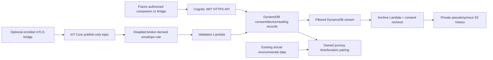

# Phase 5 wearable-independent telemetry

Hardware check update 2026-10-11: the user's OPPO phone is ADB-authorized and nRF Connect receives
vendor 0x0AF7 notifications. The discovered watch session exposes proprietary 0x0AF0 services,
not standard Heart Rate 0x180D/0x2A37. No Noise health metric was decoded/ingested. The frontend now
has an opt-in standard Bluetooth adapter and protected latest-record display mapping, described
in [LIVE_WATCH_SETUP.md](LIVE_WATCH_SETUP.md). Cloud deployment, vendor SDK/API/export support and
physical measured-data validation remain unverified. Earlier Phase 5 deployment statements below
describe that phase's evidence, not successful cloud/hardware health integration now.

Verified 2026-10-10 IST. Backend and offline tests work; **no AWS resource, certificate,
MQTT connection or physical watch connection has been deployed/tested**. The user confirmed
Noise ColorFit Pro 3 Alpha and NoiseFit Assist. [Official Noise support](https://support.gonoise.com/support/solutions/articles/47001212418-my-watch-is-not-pairing-with-bluetooth-auto-disconnect)
confirms the app. Watch OS, public health/export API and Health Connect support remain
unverified. Do not assume Wear OS, raw heart rate access, MQTT or an air pollution sensor.
No Bluetooth reverse engineering, proprietary app scraping or hardware connector is implemented.

## Architecture and transport choice



HTTPS is the implemented mobile-facing contract: verified Cognito access JWT, server-derived
owner, no app AWS keys. The optional MQTT path is for a separately compatible authorized mTLS
bridge, not an assumption about the Noise watch. Cognito User Pool JWTs do not directly authorize
IoT MQTT. SigV4 MQTT-over-WebSockets would require an authenticated Cognito Identity Pool,
short-lived scoped IAM credentials, identity/thing ownership mapping and per-identity IoT policy;
it is evaluated but not enabled. Do not give a mobile app an IAM user's access keys or this
operator's certificate. No unauthenticated identity pool or fleet-wide subscribe permission.

Core/Data remain existing stacks. Data adds one on-demand streamed wearables table; Core adds
one archive Lambda and encrypted one-day failure queue plus two alarms. Optional IoT stack
adds a validation Lambda, one-day failure queue, two alarms and disabled IoT Rule. No Thing or
certificate is auto-enrolled. No NAT, Fargate, endpoint, identity pool or new database server.
Existing API/Cognito, private data bucket and route/environmental services are reused.

## Data and API contract

All GETs require ecoroute/read; POST/DELETE require ecoroute/write. Token subject is authoritative.
POST /devices/register accepts manufacturer, model and bridge; Idempotency-Key required. It
creates a random device_id owned by the subject, with all consent disabled. Registration does
not assert hardware compatibility. POST /wearables/consent accepts device_id, telemetry,
location, history, correlation and policy_version=wearable-v1. False telemetry requires all
dependent scopes false. Every change advances a consent revision checked atomically at ingest.

POST /wearables/measurements accepts this shape (replace IDs/time with actual authorized values):

```json
{
  "device_id":"32_HEX_REGISTERED_ID", "user_id":"VERIFIED_COGNITO_SUB",
  "event_id":"32_HEX_STABLE_SOURCE_EVENT", "timestamp":"2026-10-10T00:30:00+05:30",
  "heart_rate_bpm":80, "activity":"walking", "steps":1200, "steps_semantics":"daily_total",
  "provenance":{"bridge":"companion_https","sensor":"ACTUAL_AUTHORIZED_SOURCE",
                "source_record_id":"STABLE_PROVIDER_RECORD_ID","synthetic":false}
}
```

That body is a schema example, **not measured watch data**. GPS is optional position
{longitude,latitude} plus accuracy_m, and requires separate location consent. Optional journey_id
must refer to the owner's stored journey for HTTPS. MQTT journey linking is rejected: use HTTPS
until a separately authorized registry/journey bridge exists. Missing health fields stay absent;
at least heart rate, steps or GPS is required. Integer heart rate20–250 and steps0–200000 are
engineering input bounds, not diagnostic ranges. Steps need daily_total or interval_count semantics.
Timezone-aware timestamps normalize to UTC; accepted window is past7days through future5minutes.
Persist event_id across retries: identical events replay200; changed content with the same ID409.
No automatic physiological inference, stress score or raw pollution value from the watch.

GET /wearables/latest?device_id=... returns latest by observed time, ignoring delivery order.
GET /wearables/history requires device_id,start,end; max7days, limit1–200, opaque next_cursor
scoped to that owner/device/window. Expired rows are hidden even before physical DynamoDB TTL.
Operational reading retention is7days under telemetry consent; history additionally permits
history queries and private S3 export. Correlation has its own consent. Revocation blocks ingest
and reads immediately after the update commits; in-flight writes use atomic revision checks.

DELETE /wearables/data?device_id=... first revokes and tombstones the device permanently, then
removes DDB measurement/idempotency rows and the exact S3 prefix. Cloud deletion is bounded
to200 objects/rows per prefix per request; repeat while deletion_pending_repeat_request. No
ingestion can refill the deleted device. Register a new ID if enrolling again. A minimal
device/consent tombstone remains90days. DynamoDB stream/retry records can persist up to24h;
in-flight archive writes recheck consent/deletion and remove their object if it changed. Health
data is not a public export. Existing /wearables/telemetry now returns410 for authenticated valid
requests so its earlier consent-only contract cannot bypass device revocation.

S3 key: wearables/<SHA256-owner-sub>/<device-id>/date=<UTC-date>/<event-id>.json.
Direct subject is omitted, but device/hash/GPS/health readings are re-identifiable: this is
**pseudonymous private history, not anonymized data**. No public/anonymized export is enabled.
SSE-S3/TLS/private bucket,7day lifecycle,90day device registry TTL, request limits and no-store
responses apply. Local equivalents live under ignored work/wearable-history and SQLite. Local
files rely on device OS permissions/disk encryption; they are not AWS encryption emulation.

## Journey correlation and scientific limits

Create an owned trip with optional route_id linking an already stored owned route. GET
/journeys/{journey_id}/wearable-correlation?device_id=... loads that real road route, bounded
telemetry and the existing pollution index. Pair only within the segment traversal window and
near its planned segment midpoint; GPS accuracy must be <=100m. Actual sample coordinates/time
query the existing provenance-aware station/grid index. Missing coverage is unavailable, never
zero. The result is descriptive proximity/time pairing, not a measured route dose or proof the
user followed the planned route. Sparse telemetry produces no concentration-time integral.
Synthetic unit tests verify the join; no actual watch journey correlation was collected.

Heart rate is not a pollution measurement and no causal or diagnostic claims are made.
Environmental alerts/SNS delivery are optional and currently deferred. No single-hour PM2.5
sample is compared against a 24-hour guideline. A future alert requires a sourced threshold,
matching averaging window/coverage and notification consent; the API returns no medical score.

## Local verification and future adapter

```powershell
.\.venv\Scripts\python.exe scripts/simulate_wearable.py
.\.venv\Scripts\python.exe -m pytest tests/test_wearable.py tests/test_infra.py -q
.\.venv\Scripts\python.exe scripts/smoke_local.py
```

Simulator is an offline MQTT Rule-envelope simulator, not a network broker. It writes explicitly
synthetic examples only under work/wearable-demo and confirms duplicate detection. It refuses
ECOROUTE_PROFILE=aws; AWS workers reject synthetic/demo payloads. No auth bypass exists in HTTP.
WEARABLE_DEMO_MODE allows synthetic HTTP tests only in LOCAL and defaults false.

WearableBridge in wearable/models.py defines available_permissions() and measurements(since).
A future authorized Android adapter must first verify that a source actually writes the desired
data to [Health Connect](https://developer.android.com/health-and-fitness/health-connect/get-started),
request each permission, preserve source record IDs/timestamps/units, and stop collection when
permissions or backend consent are revoked. Wear OS is a separate optional adapter only for
supported devices. Neither adapter or an Android app is implemented here. NoiseFit Assist
compatibility cannot be inferred from this contract.

## Credentials, IAM and exact enrollment steps

Before any AWS operation: select dev-admin / IAM user devesh_eco and user-confirmed credit
account, Mumbai ap-south-1. Missing/unverified: scoped IAM, CDK bootstrap, deployed Core/Data/IoT
resources, Cognito IDs/login, wearable table, private bucket, IoT endpoint, Thing/certificate
binding, quota checks and budget alert recipient. No authenticated AWS action was taken in
Phase5; previous Lambda access was denied. Finish this configuration and obtain deployment
approval before executing the following provisioning examples. Never use root keys.

| Name / mandatory status / sensitivity | Use, exact acquisition, secure storage, verification and charges |
|---|---|
| AWS_PROFILE, AWS_REGION, EXPECTED_AWS_ACCOUNT_ID; mandatory cloud; identifiers non-secret, cached credentials secret | Existing authorized CLI profile; renew its approved login locally. STS command below verifies account/non-root identity. Keep identifiers in ignored .env, credentials in AWS credential provider. STS has no direct charge |
| Cognito User Pool/Client IDs and OAuth PKCE login; mandatory HTTPS; IDs non-secret, JWT secret | After approved Core deployment: Cognito → User pools → EcoRoute Users → App integration → public client/domain. Add exact callback URI and read/write scopes, create invited user, use Authorization Code+PKCE (no client secret). Existing checklist covers login. Cache tokens in platform secure storage, not Git/chat. Verify protected health-data call: missing token401, other owner404/403. Cognito/API/Lambda usage charges |
| WEARABLES_TABLE and S3_DATA_BUCKET; mandatory cloud; names non-secret, readings sensitive | Approved Data stack outputs; DynamoDB → Tables → wearables and S3 → AirData → Permissions/Properties. Store names in .env only for local cloud operators; deployed Lambda env set by CDK. DescribeTable verifies ACTIVE/stream/TTL; bucket must block public access and enforce TLS. Request/storage charges |
| IoT Thing, owner_key, device_id; mandatory MQTT only; IDs pseudonymous/private configuration | First authenticated registration/consent. IoT Core → Manage → All devices → Things → Create single thing named eco-DEVICE_ID, attribute owner_key matching registration topic hash. No assumed watch connection. Verify DescribeThing and ListThingPrincipals. Registry operations billed |
| IOT_DATA_ENDPOINT; mandatory MQTT only; non-secret | IoT Core → Settings → Device data endpoint; use ATS hostname from describe-endpoint --endpoint-type iot:Data-ATS. Store hostname locally; endpoint command below is read/config discovery. IoT messages/connections billed |
| Certificate public ID/PEM and private key; mandatory mTLS only; private key SECRET | Generate a CSR/private key locally on the authorized bridge (or hardware secure element). IoT Core → Security → Certificates → Create → supply CSR; download signed public cert, activate it, attach exact thing/policy. If Console generates keys instead, download once directly into protected storage. Never copy private key to chat/repo/backend; use OS keystore/restricted directory. IOT_CERT_PATH/IOT_PRIVATE_KEY_PATH are paths only. Verify ACTIVE, exact attachment and binding script. Enrollment requests and subsequent usage can incur charges |
| IoT policy; mandatory mTLS only; non-secret authorization document | Run offline plan below; IoT Core → Security → Policies → Create using generated JSON, name eco-DEVICE_ID; attach only that policy to the certificate and exactly one matching Thing. Only exact client Connect and exact owner/device Publish; no Subscribe/Receive. Verify GetPolicy/ListAttachedPolicies; binding script compares exact policy. Policy management itself not standing compute |
| Lambda/stream roles; mandatory cloud; ARN non-secret | CDK defines separate API, validation and archive roles. IAM → Roles → generated role → inline policies/trust; Lambda → Configuration → Permissions; IoT rule → Lambda action. Validate with synthesized tests and an approved mTLS/HTTPS event. Never grant mobile clients PassRole. Lambda/CloudWatch/queue charges |
| Budget and credit expiry; mandatory before paid work; billing/email private | Billing → Credits verify expiry/eligible IoT services; Budgets → create proposed increment warning with actual recipient. Authorized operator only. Alerts are delayed warnings, never hard caps. Store billing settings in Console/private local config |

Runtime IAM: API GetItem/PutItem/ConditionCheckItem/Query/DeleteItem only wearable table;
S3 DeleteObject wearables/* and ListBucket constrained by wearable prefix. Validation role
GetItem/PutItem/ConditionCheckItem only wearable table, exact log writes and failure queue send.
Archive role GetItem on wearable table, DescribeStream/GetRecords/GetShardIterator on exact
stream, required ListStreams Resource* constrained to region; PutObject/DeleteObject wearables/*,
exact log and failure queue writes. IoT invokes only validator through source-account AND exact
rule ARN resource permission. No wildcard action/health subscriptions are granted.

Operator enrollment needs iot:CreateThing/DescribeThing, CreatePolicy/GetPolicy, AttachPolicy,
AttachThingPrincipal/ListThingPrincipals, DescribeCertificate/ListAttachedPolicies and
CreateCertificateFromCsr (or CreateKeysAndCertificate only if Console key generation is selected).
Binding operator needs DynamoDB GetItem/PutItem on exact wearable table. Cleanup additionally
UpdateCertificate, DeleteConnection, DetachPolicy/DetachThingPrincipal, DeleteCertificate,
DeleteThing/DeletePolicy scoped where AWS supports resources. DescribeEndpoint and certificate
creation require actions without resource-level scope; keep these operator-only exceptions.
IAM deployment/PassRole privileges remain separately reviewed, not AdministratorAccess.

```powershell
# Offline plan only; use actual NONSECRET account/hash/device identifiers.
.\.venv\Scripts\python.exe scripts/iot_device_plan.py --account ACCOUNT_ID --owner-key OWNER_HASH --device-id DEVICE_ID
# Read checks require scoped IAM; nothing here is claimed executed against IoT.
aws sts get-caller-identity --profile dev-admin --region ap-south-1
aws iot describe-endpoint --endpoint-type iot:Data-ATS --profile dev-admin --region ap-south-1
aws iot describe-thing --thing-name eco-DEVICE_ID --profile dev-admin --region ap-south-1
aws iot describe-certificate --certificate-id CERT_ID --profile dev-admin --region ap-south-1 --query 'certificateDescription.status'
# Only after approval: create the planned registry objects (no private key in these JSONs).
aws iot create-thing --cli-input-json file://work/iot/create-thing.json --profile dev-admin --region ap-south-1
aws iot create-policy --cli-input-json file://work/iot/create-policy.json --profile dev-admin --region ap-south-1
# Bind only AFTER Console certificate/policy/thing enrollment; omit --apply for offline dry-run.
.\.venv\Scripts\python.exe scripts/bind_iot_certificate.py --device-id DEVICE_ID --owner-sub VERIFIED_SUB --certificate-id CERT_ID --table WEARABLES_TABLE --profile dev-admin --apply
```

Binding checks expected non-root account, certificate ACTIVE, exact Thing attachment/owner
attribute and the sole exact policy before conditional registry update. No private key is handled.
Enable the disabled rule only after costs/security review and approval. Valid broker envelope
requires exact topic, client ID and registered certificate thumbprint; payload user_id cannot
override ownership. AWS CLI IoT Publish and Console MQTT test use IAM principals, so this mTLS
validator intentionally rejects them. For the actual pipeline use a cert-capable MQTT client,
for example an independently installed mosquitto_pub with your protected local key files:

```powershell
mosquitto_pub -h ATS_ENDPOINT -p 8883 --cafile ROOT_CA_PATH --cert CERT_PATH --key PRIVATE_KEY_PATH -i eco-DEVICE_ID -t ecoroute/users/OWNER_HASH/devices/DEVICE_ID/measurements -q 1 -f ACTUAL_AUTHORIZED_MESSAGE_FILE
```

No secret appears in that message file; it is still private health data and stays outside Git.
PUBACK proves broker receipt, not storage success. Verify owned latest/history via authenticated
HTTPS and sanitized CloudWatch statuses. Test another topic, spoofed subject, duplicate and
revoked consent: expect no unauthorized stored readings. Revoke backend consent first, then
IoT Core → Security → Certificates → select cert → Actions → Deactivate. An operator can run
update-certificate --certificate-id CERT_ID --new-status INACTIVE, followed by
`aws iot-data delete-connection --client-id eco-DEVICE_ID --endpoint-url https://ATS_ENDPOINT --profile dev-admin --region ap-south-1`, to stop new and existing broker access. Delete
data separately through the authenticated endpoint; detach/delete cert/Thing/policy after review.

## Cost proposal and remaining limits

Official [Mumbai AWS IoT offer JSON](https://pricing.us-east-1.amazonaws.com/offers/v1.0/aws/AWSIoT/current/ap-south-1/index.json),
published2026-10-03, checked2026-10-10: messaging USD1.05/million first-tier messages;
connection USD0.092/million minutes; rules USD0.158/million triggers and actions each;
registry/shadow USD1.31/million operations. Billing meters and free-credit eligibility depend
on current account terms; [pricing](https://aws.amazon.com/iot-core/pricing/) explains payload units.

Example:3 connected bridges, one <=5KB message/minute,24h/day for30days =129600 messages,
minutes, rule triggers and one Lambda rule action each: approximately **USD0.189 IoT-only**.
This excludes Lambda, DynamoDB transactional reads/writes/streams, S3 PUT/storage/delete/list,
CloudWatch alarms/logs, queues, API Gateway, Cognito, registry enrollment and taxes. Propose
USD5 incremental monthly warning allowance for this bounded demo, subject to a concrete final
deployment estimate and approval; it is not an all-inclusive forecast or spending cap.
Existing project-service charges/credits are separate. No money was spent on AWS provisioning.

Table throughput caps10 read/write request units, Lambda concurrency1,30s timeout, archive
batch10/retries2/maxage1h and queue1day bound processing/storage. They do not cap broker billing;
invalid messages and duplicate publishes still incur IoT usage. Consent revocation blocks health
processing, while certificate deactivation/disconnect stops broker access. Do not leave demo
clients running indefinitely. Account IoT quotas remain unverified; [Mumbai service/quotas](https://docs.aws.amazon.com/general/latest/gr/iot-core.html)
are service-level documentation, not evidence of account permissions.

Official contracts: [authorization](https://docs.aws.amazon.com/iot/latest/developerguide/iot-authorization.html),
[Thing variables](https://docs.aws.amazon.com/iot/latest/developerguide/thing-policy-variables.html),
[SQL encode/principal/topic](https://docs.aws.amazon.com/iot/latest/developerguide/iot-sql-functions.html),
[Lambda action/source restrictions](https://docs.aws.amazon.com/iot/latest/developerguide/lambda-rule-action.html).
IAM action/resource support: [IoT](https://docs.aws.amazon.com/service-authorization/latest/reference/list_iot.html)
and [DynamoDB](https://docs.aws.amazon.com/service-authorization/latest/reference/list_dynamodb.html).
Current boto3/CDK/Pydantic pins are reused; offline SDK shape checks validate CreateThing,
CreatePolicy and DynamoDB transaction requests. No new package compatibility assumption.
